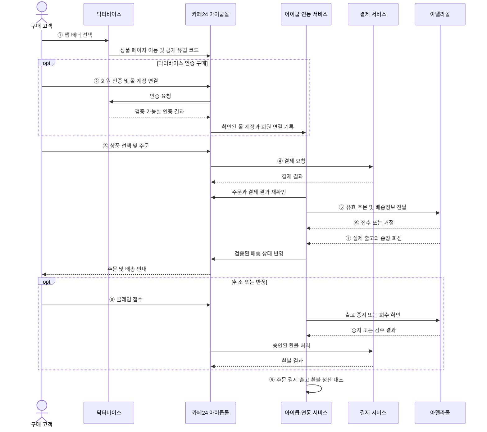
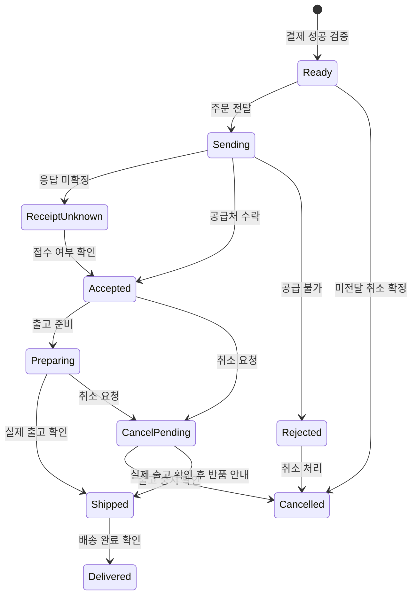
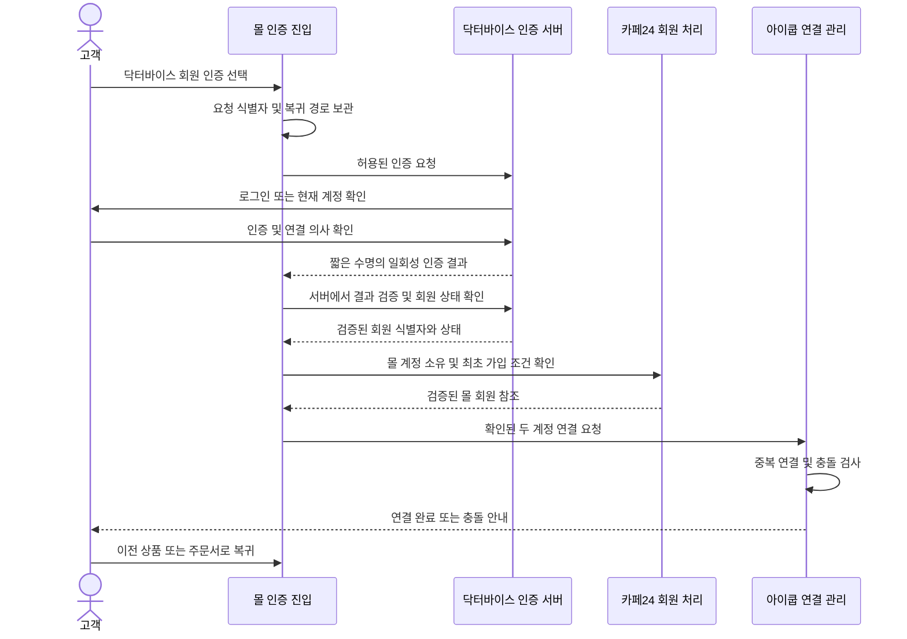
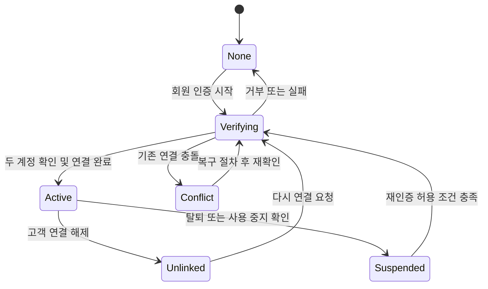
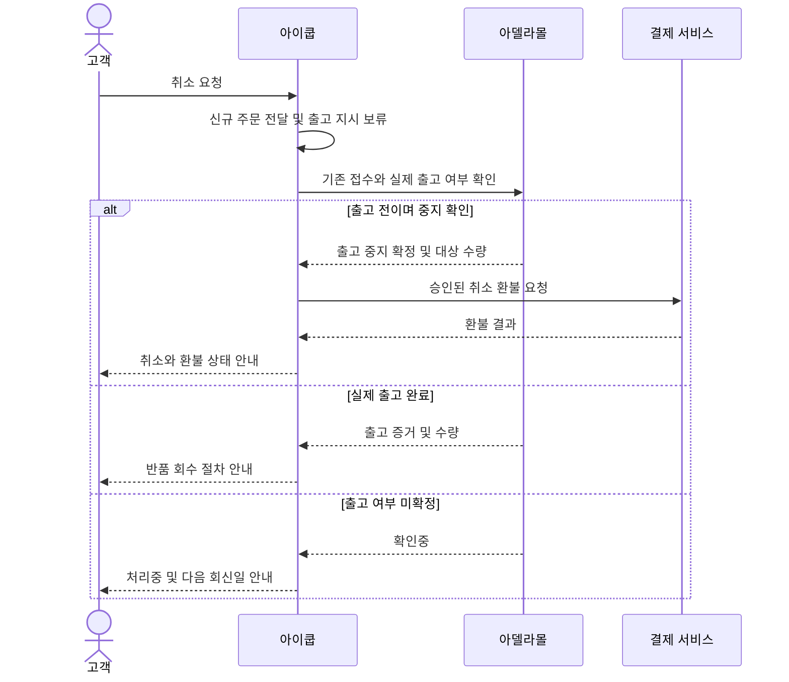

# [PRD] 카페24 기반 아이쿱몰 (닥터바이스 회원 인증 · 아델라몰 배송 연동)

| 문서 정보 | 내용 |
| :--- | :--- |
| **최종 수정일자** | 2026년 10월 29일 |
| **작성자** | 아이쿱 서비스기획 / 담당자 TBD |
| **서비스명** | 아이쿱몰(iKooB Mall) — FSL2 온라인 판매 |
| **주요 대상** | 닥터바이스 회원 및 FSL2 구매 고객, 아이쿱 운영·CS·재무 담당자 |
| **구축 기반** | 카페24 신규 쇼핑몰 / 닥터바이스 앱 배너 연결 |
| **주요 연동** | 닥터바이스 회원 인증·몰 계정 연결 / 아델라몰 주문·배송 연동 |
| **판매 및 결제 주체** | **아이쿱 [확정]** |
| **상품 공급 및 배송** | **아델라몰 [협의중]** — 실제 계약 법인명·업무 범위·인터페이스 TBD |
| **인허가 전제** | **의료기기 판매업 및 통신판매업 신고 완료 [확정]** |
| **목표 일정** | **2026년 12월 MVP 오픈** / 세부 기준일은 9.3 참조 |
| **문서 상태** | Draft **v1.0** — 사업·정책·기술 검토 및 개발 협의용 |
| **화면설계서** | 본 문서 4.6~4.8 및 6.4에 IA·와이어프레임 포함 / Figma URL TBD |

> **참고 문서**
>
> * 기존 「아이쿱 FSL2 온라인 판매 서비스기획서 v0.9」 — 판매·운영 구조의 출발점. **회원 인증·배송 연동의 개발 범위는 본 PRD가 우선**한다.
> * [카페24 SSO 로그인 연동 가이드][ref-sso] — 외부 서비스 계정으로 몰에 로그인하는 구조 검토.
> * [카페24 API 시작하기][ref-api] — 인증·통신·API 유형 확인.
> * [국민건강보험공단 소모성재료 구입비 안내][ref-nhis] — 요양비 검토 근거. 위임청구는 1차 제외.
> * [문서 개정 이력](PRD_카페24_기반_아이쿱몰_개정이력.md) — 버전별 변경 및 결정 기록.

> **문서 구성 — 공통 → 닥터바이스 회원 인증 → 아델라몰 배송 연동**
>
> | 구분 | 장 | 내용 |
> | :--- | :--- | :--- |
> | **공통** | 1~5장 | 배경·목표·권한·서비스 구조·상품·주문·결제·클레임·화면·공통 데이터 모델 |
> | **닥터바이스 회원 인증** | 6장 | 인증 방식·계정 연결·인증 상태·화면·인터페이스·구매 귀속 |
> | **아델라몰 배송 연동** | 7장 | 주문 전달·접수·출고·송장·취소·반품·재처리·데이터 모델 |
> | **공통 마무리** | 8~11장 | 비기능 요구사항·범위·수용 기준·일정·미결 과제·개정 이력 |

> **개발 범위 표기 — 🟢 1차 개발 / 🟡 후속 개발 / 🔴 확인 필요**
>
> **닥터바이스 회원 인증 가능 상태와 아델라몰 배송 연동은 1차 필수 범위다.** 기술 지원 여부가 미확정이라는 이유로 자동 제외하지 않는다. 지원 방식·계약·실행 일정은 10장 OI로 관리한다.
>
> | 구분 | 🟢 1차 개발 | 🟡 후속 개발 |
> | :--- | :--- | :--- |
> | **몰·구매** | 카페24 신규 몰, FSL2 상품·장바구니·주문·결제·주문 조회 | 상품군 확대·정기구독·고도화 프로모션 |
> | **앱 연결** | 닥터바이스 배너, 외부 브라우저 이동, 공개 유입 코드 | 앱 내 주문내역 통합 표시 |
> | **회원 인증** | 닥터바이스 회원 인증, 몰 계정과 안전한 연결, 연결 해제·충돌 처리 | 전 서비스 통합 계정·통합 탈퇴 |
> | **구매 식별** | 유입 경로와 회원 인증을 분리, 인증 구매의 주문 시점 연결 기록 | 구매 기반 CGM LiVE 이용권·사용자별 서비스 자격 부여 |
> | **배송 연동** | 결제 확인 주문 전달, 접수 결과, 출고·송장 반영, 취소·반품 협업 | 실시간 WMS·재고 자동화 확장 |
> | **운영** | 아이쿱 CS, 환불, 일별 대사, 공급 정산, 권한·개인정보 관리 | ERP 통합·운영 자동화 확장 |
> | **보험·건강 데이터** | 승인된 일반 안내만 제공 | 요양비 위임청구, 리브레·CGM LiVE·보호자 앱의 데이터 연계 |

> **확정 수준 및 우선순위**
>
> * **[확정]**: 사업 전제로 확인된 사항. **[가정]**: 설계 진행을 위한 승인 전 제안. **[협의중] / TBD**: 계약·정책·기술 확인 필요.
> * **P0**: 오픈 필수. **P1**: 1차 안정화 후 개선. **P2**: 별도 사업·보안·인허가 검토 후 추진.
> * 별도 확정 표시가 없는 요구사항은 **설계 제안**이다. 계정 연결 수, 코드 만료, 운영 SLA 등 수치는 승인 전 정책으로 공표하지 않는다.

---

## 1. 기획 배경 및 문제 정의

### 1.1 기획 배경

아이쿱은 닥터바이스 이용자가 앱 배너에서 자사몰로 이동해 FSL2를 구매할 수 있도록 **카페24 기반 신규 아이쿱몰**을 구축한다. 판매·결제는 아이쿱이 담당하고, 아델라몰이 상품 공급·배송을 수행하는 구조를 협의 중이다.

**의료기기 판매업 및 통신판매업 신고는 이미 완료되어 있다.** 이번 기획은 신규 신고 취득을 전제로 하지 않으며, 신규 몰의 표시사항·운영 정보·위탁 구조·배너 추가에 따른 별도 검토사항을 다룬다.

단순 구매 링크를 넘어, 고객이 **닥터바이스 회원임을 인증하고 해당 구매를 올바른 몰 계정에 연결할 수 있는 구조**를 1차에 제공한다. 구매자 인증과 혈당 데이터 연계는 별도 범위로 관리한다.

### 1.2 문제 상황 (Pain Points)

* **고객**
  * 앱에서 몰로 이동할 때 판매자·로그인 상태·구매 내역 확인 경로가 불분명할 수 있다.
  * 닥터바이스 회원임에도 몰에서 이를 확인할 방법이 없으면 회원 기반 구매 식별이 어렵다.
  * 결제·배송·환불 문의를 여러 사업자에게 반복하는 불편이 발생할 수 있다.
* **아이쿱 운영·CS**
  * 결제 완료 주문의 공급처 전달·접수·송장 회신이 분리되면 누락·중복 출고 위험이 생긴다.
  * 앱 유입과 실제 회원 인증을 혼동하면 구매 통계와 고객 응대가 부정확해진다.
  * 취소 요청과 실제 출고가 동시에 발생하면 환불·회수·정산 기준이 충돌한다.
* **개발·파트너 협업**
  * 카페24 표준 기능, 닥터바이스 인증 기능, 아델라 인터페이스의 책임 경계를 먼저 정해야 한다.
  * 자동 로그인·자동 배송이 가능한 것으로 가정하고 화면부터 만들면 지원 규격에 따라 재설계가 필요하다.

### 1.3 서비스 목표 (Goals)

> **서비스 정의**
>
> 닥터바이스 앱에서 진입해 **회원 인증과 FSL2 구매가 가능하고**, 아이쿱이 판매·결제·고객 응대를 책임지며, 아델라몰의 공급·배송 결과를 주문 단위로 확인할 수 있는 온라인 판매 서비스.

1. **고객에게** 판매 주체·인증 상태·결제·배송·환불 진행을 일관되게 안내한다.
2. **운영자에게** 결제부터 공급처 접수·송장·클레임·정산까지 추적 가능한 처리 기록을 제공한다.
3. **사업 관점에서** 닥터바이스 유입 구매와 인증 회원 구매를 구분해 집계하고 후속 서비스 연결의 기반을 마련한다.

### 1.4 초기 적용 대상 및 기본 정책

| 항목 | 1차 기준 | 확정 수준 |
| :--- | :--- | :--- |
| 판매 상품 | FSL2 중심. 정확한 국내 제품명·모델·구성·SKU·가격은 상품 마스터로 확정 | TBD / OI-01 |
| 구매 지역·통화 | 국내 배송·원화 결제 | [가정] |
| 일반 구매 | 닥터바이스 미인증 고객도 일반 구매 가능 | [가정] / OI-02 |
| 회원 인증 | 닥터바이스 계정 소유 확인 및 회원 상태 확인 기능 제공 | **1차 요구사항** |
| 인증 구매 | 몰 회원 로그인과 닥터바이스 계정 연결이 완료된 주문에 인증 정보를 기록 | [가정] / 6장 |
| 비회원 구매 | 일반 구매는 허용하되 닥터바이스 계정과 자동 연결하지 않음 | [가정] / OI-02 |
| 회원 혜택 | 인증만으로 할인·급여·서비스 이용권이 부여되는 정책은 없음 | 추가 혜택 TBD / OI-03 |
| 요양비 | 일반 전액 결제. 위임청구 신청·서류 접수·본인부담금만 결제는 제외 | [가정] / OI-17 |

---

## 2. 사용자 및 시스템 권한 정의

| 역할 | 접속 채널 | 주요 역할 | 권한 제한 |
| :--- | :--- | :--- | :--- |
| **닥터바이스 회원** | 닥터바이스 앱·아이쿱몰 | 배너 진입, 회원 인증, 계정 연결·해제, 구매·본인 주문 조회 | 타인 주문 조회·타인 계정 연결 불가 |
| **일반 몰 회원** | 아이쿱몰 | 로그인·구매·본인 주문 조회, 닥터바이스 인증 시작 | 인증 완료 전 인증 회원으로 표시하지 않음 |
| **비회원 구매자** | 아이쿱몰 | 일반 구매·비회원 주문 확인·클레임 접수 | 주문번호만으로 개인정보 조회 불가. 개인 계정 귀속 없음 |
| **아이쿱 운영자** | 카페24 관리자·연동 운영 화면 | 상품·재고·주문 전달·접수·송장·연동 예외 처리 | 결제 성공 임의 입력, 회원 연결 임의 덮어쓰기 금지 |
| **아이쿱 CS** | 관리자·CS 대장 | 주문 문의·취소·반품·품질 문의·연결 복구 접수 | 인증 비밀정보 조회 불가, 환불 실행 권한 별도 |
| **아이쿱 재무** | 관리자·PG·정산 대장 | 결제·환불·입금 대조, 공급 정산·증빙 | 상품 배송 상태 임의 변경 불가 |
| **개인정보·인허가 담당자** | 검토 문서·감사 화면 | 위탁·제공·보관·파기·표시광고·앱 변경 검토 | 실제 고객 데이터는 업무상 필요한 범위로 제한 |
| **아델라 담당자** | 계약된 연동 시스템·제한된 운영 채널 | 배정 주문 접수·공급불가·출고·송장·회수·검수 회신 | 닥터바이스 ID·인증 토큰·혈당·질환정보 접근 불가 |
| **시스템 관리자** | 운영 관리 도구 | 연동 설정·비밀정보·접근권한·장애 복구 | 업무 승인 없이 환불·계정 병합 처리 금지 |

* 권한은 **조회 / 다운로드 / 처리 / 승인 / 설정 변경**을 구분한다. 실명 담당자와 대체 담당자는 OI-20에서 확정한다.
* 운영자·CS의 주문 조회는 업무 목적과 접근 기록을 남긴다. 고객에게 노출되는 인증 배지만으로 주문 접근 권한을 부여하지 않는다.
* 아델라 계정이 카페24 관리자에 접근하는 대안을 택할 경우 배정 주문·필요 필드만 제한할 수 있는지 검증한다. 제한이 불가능하면 해당 방식을 사용하지 않는다.

---

## 3. 서비스 범위 및 데이터 연동 구조

### 3.1 대상 서비스 및 책임 경계

| 구성 | 책임 | 기준 데이터 |
| :--- | :--- | :--- |
| **닥터바이스 앱** | 배너·회원 인증 진입·앱 복귀 안내 | 앱 로그인 상태·회원 계정 |
| **닥터바이스 인증 서버** | 계정 소유·회원 상태 확인, 인증 결과 제공 | 닥터바이스 회원 고유 식별자·상태 |
| **카페24 아이쿱몰** | 상품·장바구니·몰 회원·주문·고객 조회 | 몰 회원·주문·품목·판매금액 |
| **PG** | 결제·취소·환불·입금 처리 | 결제 거래·환불 결과 |
| **아이쿱 연동 서비스** | 회원 연결·주문 식별·배송 중계·대사·예외 기록 | 연결 이력·연동 작업·매핑·대조 결과 |
| **아델라몰** | 공급 가능 여부·주문 접수·출고·송장·회수·검수 | 공급처 접수·물리적 출고·검수 결과 |

> 🔴 **연동 서비스의 실제 배치 위치는 미정이다.** 기존 아이쿱 서버·신규 중계 서버·카페24 앱 중 어디에 구현할지 OI-04에서 결정한다. 논리 역할을 별도 신규 시스템 구축 확정으로 해석하지 않는다.

#### 3.1.1 설계 전제

| 구분 | 원칙 | 설계 영향 |
| :--- | :--- | :--- |
| 앱 유입 | 배너·캠페인 코드는 유입 분석 정보 | 회원 인증 증거로 사용하지 않음 |
| 회원 인증 | 닥터바이스의 신뢰할 수 있는 인증 결과 | 전화번호·이메일 일치만으로 대체하지 않음 |
| 몰 로그인 | 카페24 세션과 몰 계정 확인 | 앱 로그인 상태가 자동 승계된다고 가정하지 않음 |
| 구매 귀속 | 주문 생성 시점의 확인된 연결 참조 | 연결 해제·재연결로 과거 주문을 다른 계정으로 이전하지 않음 |
| 공급 접수 | 공급처의 주문·품목별 수락 결과 | 전송 성공과 분리 |
| 출고 | 실제 출고 증적과 출고수량 | 송장 생성만으로 출고 완료 처리하지 않음 |

### 3.2 지표 산출 정의 — 공통 원칙

> 지표는 이 절에서 정의하고 다른 절에서는 번호를 참조한다. 회원 인증·주문 상태는 4.4·6.3의 기준을 사용한다. 조회기간은 KST 기준으로 해석하고 집계 원본 시각에는 시간대를 보존한다.

| # | 유형 | 지표 | 산출식·정의 | 사용처 |
| :--- | :--- | :--- | :--- | :--- |
| M01 | 수집 | 배너 클릭 수 | 수집 가능한 클릭 이벤트. 반복 클릭 포함 여부를 함께 표시 | 유입 분석 |
| M02 | 파생 | 유입 확인 결제 주문 수 | `source_code=doctorvice`가 주문에 보존된 결제 성공 주문 수 | 채널 성과 |
| M03 | 파생 | 인증 회원 결제 주문 수 | 주문 시점 유효한 회원 연결 스냅샷이 있고 결제 성공한 주문 수 | 인증 구매 집계 |
| M04 | 파생 | 인증 완료율 | 동일 `auth_transaction_id` 기준 인증·연결 완료 건 / 시작 건. 재시도 중복 제거 | 인증 UX |
| M05 | 파생 | 공급처 미접수 건수 | 결제 성공·전달 대상 중 접수 결과 미확정 건 | 운영 우선 처리 |
| M06 | 파생 | 출고 SLA 준수율 | 약속 출고기한 안에 실제 출고한 대상 품목 수 / 해당 기간 출고기한 도래 품목 수 | 공급 운영 |
| M07 | 파생 | 환불 지연 건수 | 고객에게 고지된 처리기한을 넘긴 미완료 환불 건. 법정 기준도 별도 준수 | CS·재무 |
| M08 | 파생 | 미대사 금액 | 주문·PG·환불·공급 정산에서 원인과 처리 계획이 확정되지 않은 차액 | 재무 마감 |

* M02와 M03은 일치할 필요가 없다. 배너로 들어온 비회원 구매는 M02에만, 직접 방문 후 인증한 구매는 M03에만 포함될 수 있다.
* M02·M03의 결제 성공 집계와 취소·환불 후 순매출은 별도로 제공한다. 주문 건수와 품목수량을 섞지 않는다.
* 쿠키 차단·다른 브라우저·직접 방문은 `unknown` 또는 `direct`로 보존한다. 추정치를 인증 구매로 보정하지 않는다.
* 오픈 검수 목표는 **타인 정보 노출·중복 출고·중복 환불 0건, 원인 미확인 차액 0원**이다. 사업 전환율 목표는 초기 2주 기준선 수집 후 확정한다.

### 3.3 전체 프로세스 — 앱 진입부터 정산까지



* 위 도식의 인증 구간은 논리 흐름이며 실제 호출 주체는 6.2의 채택안에 따라 달라진다. 몰 브라우저가 서버 신뢰값을 직접 생성하지 않는다.

| 단계 | 고객 화면 | 시스템·운영 처리 | 주요 조건 |
| :--- | :--- | :--- | :--- |
| ① 진입 | S01 → S03 | 허용 도메인 연결·유입 저장 | 회원번호·토큰을 배너 URL에 넣지 않음 |
| ② 인증 | S04~S06 | 계정 인증·연결·동의 기록 | 본인 계정 확인, 충돌 차단 |
| ③ 주문 | S07~S08 | 금액·재고·배송·인증 스냅샷 검증 | 인증 상태와 결제 가능 여부 분리 |
| ④ 결제 | S09~S10 | 성공·실패·확인중 구분 | 브라우저 복귀만으로 성공 처리 금지 |
| ⑤~⑦ 배송 | S11~S12·A01 | 전달·접수·출고·송장 대조 | 공급처 계약과 데이터 처리 근거 선행 |
| ⑧ 사후관리 | S13~S14·A02 | 취소·반품·환불·문의 이력 | 출고 중지와 PG 환불 별도 확인 |
| ⑨ 마감 | A03 | PG·공급대금·배송비·반품 차이 대조 | 고객 환불을 공급 정산 완료까지 보류하지 않음 |

### 3.4 현재 구조와 목표 구조 (As-Is / To-Be)

| 구분 | As-Is | To-Be |
| :--- | :--- | :--- |
| 판매 채널 | 신규 몰 구축 예정 | 카페24 아이쿱몰에서 아이쿱 판매·결제 |
| 신고 | 의료기기 판매업·통신판매업 신고 완료 | 완료 사실 유지, 신규 운영 관련 변경·고지 검토 |
| 앱 동선 | 현행 배너 위치·외부 링크 정책 확인 필요 | 닥터바이스 배너 → 승인된 상품 URL |
| 회원 식별 | 현행 계정·인증 API 지원 범위 미확정 | 인증된 닥터바이스 계정과 몰 계정의 연결 |
| 배송 | 아델라 공급·배송 협의중 | 주문 전달·접수·출고·송장·클레임 회신 연결 |
| 보험·앱 데이터 | 후속 가능성 검토 | 1차 일반 판매, 별도 승인 후 확장 |

---

## 4. 공통 기능 요구사항 (Functional Requirements)

> 본 장은 몰 판매·운영 공통 기능을 정의한다. 회원 인증의 상세는 **6장**, 배송 연동의 상세는 **7장**을 따른다. **FR-01~FR-19는 모두 P0**이며, 절 안의 🟡 항목만 후속 범위다.

### 4.1 [고객] 닥터바이스 배너 진입 (FR-01)

**기능 목적**

닥터바이스 이용자를 정확한 아이쿱몰 판매 페이지로 연결하고 판매 주체와 외부 이동을 안내한다.

| 항목 | 요구사항 | 제약 |
| :--- | :--- | :--- |
| 배너 위치 | 앱 내 노출 화면·대상·기간 설정 | 임상 기능과 혼동하지 않도록 앱 기획 검토 |
| 목적지 | 승인된 HTTPS 상품 상세 URL | 임의 도메인·외부 redirect URL 금지 |
| 문구 | 제품명·판매자 아이쿱·아이쿱몰 이동 안내 | 허가 범위를 벗어난 효능 표현 금지 |
| 유입 코드 | `source_code`, `campaign_code` | 공개 캠페인 정보만 사용 |
| 브라우저 | 시스템 브라우저를 기본안으로 검증 | 앱 내 WebView의 인증·PG 호환을 추정하지 않음 |
| 오류·복귀 | 연결 실패 재시도, 앱으로 돌아갈 경로 안내 | 실패를 회원 인증 또는 주문 성공으로 표시하지 않음 |

* 앱 로그인 세션이 외부 브라우저로 자동 공유된다고 가정하지 않는다.
* 앱 토큰을 URL로 넘겨 몰을 로그인시키는 방식은 사용하지 않는다. 추가 로그인을 줄이기 위한 방식은 6.2에서 검증한다.

### 4.2 [운영자] 상품 등록 및 판매 정책 (FR-02)

#### 4.2.1 상품 등록 정보

| 항목 | 입력 방식 | 필수 | 비고 |
| :--- | :--- | :---: | :--- |
| 상품명·모델·구성 | 운영자 등록 | 필수 | 정확한 국내 판매 제품·센서 수·리더기 포함 여부 |
| 몰 상품·옵션 코드 | 카페24 기준 | 필수 | 아델라 공급 SKU 매핑 |
| 판매가·통화 | 운영자 등록 | 필수 | 원화·부가세 처리 재무 확인 |
| 판매 가능 수량 | 공급처 확인 후 반영 | 필수 | 실재고·안전재고·품절 기준 OI-05 |
| 배송비·지역·예상 출고 | 정책 설정 | 필수 | 미확정 수치로 광고하지 않음 |
| 제품 허가·공급 자료 | 승인 자료 연결 | 필수 | 해당 품목에 적용되는 필수 표시사항 확인 |
| 배송·반품·교환 안내 | 승인 정책 연결 | 필수 | 4.10·7.3과 일치 |
| 유효기간·보관 안내 | 공급사 자료 기반 | 조건부 | 잔여 유효기간·로트 추적 운영 기준 확정 |
| 관련 앱 안내 | 승인된 공식 링크 | 선택 | 구매만으로 앱 계정·혈당이 연결된다고 표현 금지 |

#### 4.2.2 판매 상태 및 변경

* 판매 상태는 `판매중 / 품절 / 판매중지`를 구분한다. 품절·판매중지는 새 주문을 차단하되 기존 주문 조회를 유지한다.
* 결제 직전 가격·배송비·재고가 바뀌면 변경 금액을 보여주고 재확인받는다.
* 할인·쿠폰·적립금은 🟡 후속 기본안이다. 1차에 도입하면 부분환불·배송비·정산 배분 규칙을 함께 승인한다.
* 제조사 자료 변경·회수 공지가 있으면 승인 후 상품·배너·FAQ를 같은 버전으로 변경한다.

### 4.3 [고객·시스템] 주문 및 결제 (FR-03)

#### 4.3.1 주문서 입력

| No. | 항목 | 필수 여부 | 처리 규칙 |
| :---: | :--- | :---: | :--- |
| 1 | 품목·수량 | 필수 | 정수 1 이상, 판매 한도 내 수량 |
| 2 | 구매자 이름·휴대전화 | 필수 [가정] | 알림·거래 확인 목적에 필요한 범위 |
| 3 | 이메일 | 조건부 | 증빙·플랫폼 설정상 필요 여부 확인 |
| 4 | 수령인·연락처·주소 | 필수 | 구매자와 별도 입력 가능 |
| 5 | 배송 요청사항 | 선택 | 질환·처방 등 민감정보 입력을 요청하지 않음 |
| 6 | 결제수단 | 필수 | 계약된 PG의 실제 지원 수단만 노출 |
| 7 | 약관·개인정보 처리 안내 | 필수 확인 및 동의 구분 | 처리 근거별 설계, 선택 동의 거부 시 일반 구매 허용 |
| 8 | 닥터바이스 인증 정보 | 시스템 표시 | 직접 입력·체크박스로 인증 완료 설정 불가 |

* **진단명·주민등록번호·혈당값·처방전·위임장은 일반 주문서에서 수집하지 않는다.**
* 주문 생성 시 판매조건·가격·배송비·동의 버전·유입 정보·회원 연결 참조를 스냅샷으로 기록한다.
* 닥터바이스 인증은 **계정 인증**이며 환자 자격·보험 대상·공인 본인확인·실사용자 확인을 뜻하지 않는다.

#### 4.3.2 결제 확정 기준

1. 카페24·PG의 신뢰할 수 있는 결과에서 주문 참조·거래번호·금액·통화·결제 상태를 확인한다.
2. 정상 결제 성공 건만 배송 전달 대상이 된다.
3. 결과가 미확정이면 `확인중`으로 안내하고 서버 조회로 복구한다. 고객에게 확인 없이 재결제를 유도하지 않는다.
4. 동일 거래 통지는 한 번만 반영한다. 실제로 서로 다른 거래가 2건 발생한 이중 결제는 별도 조사·환불한다.
5. 결제 카드정보는 카페24·PG의 처리 범위를 사용하며 아이쿱 중계 서비스에 별도로 저장하지 않는다.

#### 4.3.3 인증 상태와 주문 처리

| 상황 | 처리 |
| :--- | :--- |
| 유효한 연결·인증 보유 | 주문 생성 시 연결 참조와 확인 시각을 기록 |
| 인증 미완료 | 일반 주문 가능 [가정]. `미인증 구매`로 기록 |
| 인증 확인 중·실패 | 인증 완료로 표시하지 않음. 일반 구매 진행 여부를 고객에게 명확히 안내 |
| 결제 완료 후 인증 | 과거 주문을 자동으로 인증 구매에 편입하지 않음. 소급 귀속 기능은 후속 |
| 비회원 주문 | 닥터바이스 계정 참조를 자동 저장하지 않음 |

### 4.4 [시스템] 주문 상태 라이프사이클 (FR-04)

> **결제 / 이행 / 클레임 / 환불을 각각 관리**한다. 아래 이름은 논리 상태이며 카페24 실제 상태 코드와의 매핑은 OI-06에서 확정한다.

| 축 | 상태 | 기준 |
| :--- | :--- | :--- |
| 결제 | `PENDING / PAID / FAILED / EXPIRED` | 결제 검증 결과. 환불 후에도 원결제 사실 보존 |
| 이행 | `READY / SENDING / RECEIPT_UNKNOWN / ACCEPTED / PREPARING / SHIPPED / DELIVERED` | 전달·접수·실제 출고·택배 결과 |
| 이행 예외 | `ON_HOLD / REJECTED / CANCELLED` | 보류·공급불가·출고 중지 확정 |
| 클레임 | `NONE / REQUESTED / REVIEWING / COLLECTING / INSPECTING / APPROVED / REJECTED / CLOSED` | 접수·회수·검수·판정 |
| 환불 | `NONE / REQUESTED / PROCESSING / PARTIALLY_REFUNDED / REFUNDED / FAILED` | PG의 실제 반환 결과 및 누적 금액 |



* 도식의 `CancelPending`은 **클레임 요청과 이행 보류를 함께 보여주는 설명 상태**다. 실제 구현에서 별도 이행 코드로 사용할지는 매핑표에 명시한다.
* 전송 중·접수 미확정 상태에서 취소가 들어오면 먼저 기존 접수 여부를 확인한다. 단순 미전달 주문으로 간주하지 않는다.
* 주문 전체 대표 상태와 품목·수량별 상태를 구분한다. 일부 출고·일부 반품을 전체 완료로 덮어쓰지 않는다.
* 판매 이행 출고수량 + 출고 전 취소확정수량은 주문수량을 초과할 수 없다. 교환 출고는 승인된 클레임에 연결해 별도 집계한다. 회수수량은 대상 출고 건의 미회수수량 이하이며 환불 누계는 원결제액 이하이다.
* 처리 시각·수신 시각·운영 수정 시각을 분리하고 정정 전후 값·사유·담당자를 남긴다.

### 4.5 [시스템·운영자] 고객 알림 및 예외 알림 (FR-05)

| 이벤트 | 고객 알림 | 운영 알림 | 기준 |
| :--- | :--- | :--- | :--- |
| 주문·결제 완료 | 주문번호·금액·조회 경로 | 정상 처리 집계 | 검증된 결제 성공 |
| 공급처 미접수 | 출고 약속 영향 시 지연 안내 | 미접수·재처리 필요 | 전달 성공만으로 고객에게 배송중 안내 금지 |
| 실제 출고 | 택배사·송장·조회 경로 | 송장 오류·수량 오류 | 출고 증적 확인 |
| 취소·반품 접수 | 접수번호·다음 단계 | 담당자·확인 기한 | 접수와 완료 구분 |
| 환불 완료 | 금액·수단·반영 안내 | 금액 불일치 | PG 성공 확인 |
| 회원 연결·해제 | 연결 변경 사실 안내 | 충돌·의심 시도 | 민감한 식별값은 메시지에 노출하지 않음 |
| 연동·결제 장애 | 영향 범위에 맞춘 공지 | 즉시 담당자 알림 | 정상 처리로 위장하지 않음 |

* 알림 채널은 카페24·계약 서비스의 실제 지원을 확인해 확정한다. 문자·알림톡·메일 모두 자동 제공된다고 가정하지 않는다.
* 발송 실패가 결제·출고를 취소시키지 않는다. 알림은 `업무 이벤트 + 채널` 기준으로 중복 방지하고 재발송 이력을 남긴다.
* 결제·회원 인증 토큰·주소 전체·진단정보를 알림이나 외부 분석 로그에 포함하지 않는다.

### 4.6 [고객] 몰 홈 및 상품 상세 화면 (FR-06)

#### 4.6.1 화면 정보구조 (IA)

| 화면 ID | 화면명 | 주요 진입 | 주요 이동 |
| :--- | :--- | :--- | :--- |
| S01 | 닥터바이스 배너 | 앱 내 승인된 위치 | S03 |
| S02 | 몰 홈 | 직접 방문·로고 | S03·S04·S11·S14 |
| S03 | 상품 상세 | 배너·홈 | S04·S07·S08 |
| S04 | 몰 로그인·회원 인증 선택 | 구매·마이페이지 | S05·S06·S08 |
| S05 | 닥터바이스 인증·연결 확인 | S04·S06 | 기존 목적지·S06 |
| S06 | 회원 연결 관리 | 마이페이지 | 재인증·연결 해제·S14 |
| S07 | 장바구니 | 상품 상세 | S08 |
| S08 | 주문서 | 바로구매·장바구니 | S09 |
| S09 | PG 결제·복귀 | 주문서 | S10·S12 |
| S10 | 주문 완료·확인중 | 결제 복귀 | S12·S14 |
| S11 | 마이페이지·비회원 조회 | 상단·주문 알림 | S06·S12 |
| S12 | 주문 상세·배송 조회 | 주문 목록·조회 | S13·S14 |
| S13 | 취소·반품 접수 | 주문 상세 | 처리 현황 |
| S14 | 고객센터 | 공통 메뉴·상품·주문 | FAQ·1대1 문의 |
| S15 | 정책·사업자 정보 | 공통 하단·주문서 | 약관·개인정보·배송반품 정책 |
| A01 | 주문·배송 연동 관리 | 운영자 로그인 | 전달·접수·송장·오류 처리 |
| A02 | 클레임·CS 관리 | 운영자 로그인 | 공급처 확인·환불·종결 |
| A03 | 정산·권한·감사 기록 | 권한별 관리자 | 대사·정산·다운로드·이력 |

* ID는 기획상 화면 구분이다. A01~A03을 위해 모두 새로운 관리자 화면을 개발한다는 뜻은 아니다.

#### 4.6.2 홈 및 상품 상세 와이어프레임

```text
S02 홈                         S03 상품 상세
아이쿱몰 로고 / 주문 조회       뒤로 / 아이쿱몰 / 장바구니
닥터바이스 회원 인증 안내      제품 이미지 / 정확한 제품명
FSL2 상품 카드                 구성 / 판매가 / 배송비
배송·주문 FAQ                  수량 선택 / 최종 상품금액
고객센터                       제품정보 / 배송 / 교환·반품
사업자·정책 링크               인증 상태와 인증 진입
                               [장바구니] [구매하기]
                               사업자·정책 링크
```

| 영역 | 표시·동작 | 상태 처리 |
| :--- | :--- | :--- |
| 판매 조건 | 승인 상품·판매가·구성·배송비 | 변경 시 결제 전 재확인 |
| 인증 안내 | 미연결이면 `닥터바이스 회원 인증`, 연결 시 확인 시각 포함 상태 | 실제 인증 결과 없이 배지 표시 금지 |
| 구매 버튼 | 유효 수량 선택 후 주문서 이동 | 품절·판매중지 시 비활성 및 이유 |
| 제품 이용 안내 | 승인된 공식 호환·설치·주의사항 링크 | 앱 계정·혈당 자동 연계를 암시하지 않음 |

* 홈·상세는 깔끔한 흰 배경, 모바일 우선 반응형을 기본으로 한다. 보험 예상 지원액을 기본 판매가처럼 표시하지 않는다.

### 4.7 [고객] 장바구니·주문서·완료 화면 (FR-07)

#### 4.7.1 장바구니와 주문서

```text
S07 장바구니                   S08 주문서
품목 / 수량 / 삭제             ① 상품·수량·가격 요약
상품금액 / 배송비 / 합계       ② 몰 로그인·닥터바이스 인증 상태
[주문하기]                     ③ 구매자 정보
                               ④ 수령인·주소·배송 요청
                               ⑤ 결제수단·최종 금액
                               ⑥ 약관·처리 안내·선택 동의
                               [총 N원 결제하기]
```

* 회원 인증을 위해 화면을 이동해도 장바구니·상품 선택을 복원한다. 복귀 목적지는 허용된 몰 내부 경로로 제한한다.
* 일반 구매를 허용하는 경우 `인증 없이 일반 구매` 선택지를 명확하게 제공한다 [가정]. 인증 시도 실패를 구매 성공으로 표시하지 않는다.
* 필수 입력 누락은 해당 필드 가까이에 설명하고 입력값을 보존한다. 새로고침·중복 탭은 중복 주문·결제를 만들지 않도록 플랫폼의 검증 절차를 따른다.

#### 4.7.2 결제 복귀 및 완료

| 결과 | 화면 문구 예시 | 다음 행동 |
| :--- | :--- | :--- |
| 성공 | 주문이 완료되었습니다 | 주문번호·결제금액·주문 상세 |
| 미확정 | 결제 결과를 확인하고 있습니다 | 주문 조회·고객센터. 즉시 재결제 유도 금지 |
| 실패 | 결제가 완료되지 않았습니다 | 사유 범위 내 안내·주문서로 복귀 |
| 인증 미연결 구매 | 일반 구매로 접수되었습니다 | 주문 조회·연결은 향후 주문부터 적용 |

* 인증 상태와 결제 결과는 서로 다른 표시 영역을 사용한다.
* 닥터바이스로 돌아가지 못해도 몰 주문 조회와 주문 알림으로 거래 결과를 확인할 수 있어야 한다.

### 4.8 [고객·CS] 마이페이지·주문 상세·클레임 (FR-08)

#### 4.8.1 마이페이지 및 주문 상세

| 화면·영역 | 표시 항목 | 처리 규칙 |
| :--- | :--- | :--- |
| S11 회원 영역 | 몰 계정·회원 연결 상태·S06 이동 | 인증된 몰 세션 기준 |
| S11 주문 목록 | 주문일·번호·품목·금액·대표 상태 | 본인 주문만 표시 |
| S11 비회원 조회 | 플랫폼의 비회원 인증 항목 | 주문번호 단독 조회 금지 |
| S12 요약 | 주문번호·품목·수량·금액·배송지 | 연락처·주소 마스킹 |
| S12 진행 | 결제·배송·클레임·환불 상태 | 상태별 최종 갱신 시각 |
| S12 배송 | 품목별 택배사·송장·실제 출고수량 | 송장 미수신은 배송중으로 표시하지 않음 |
| S12 행동 | 취소·반품·문의·증빙 | 현재 상태와 정책에 맞게 제공 |

#### 4.8.2 취소·반품 접수

1. 대상 품목과 수량을 선택한다.
2. 단순변심·하자·오배송·기타 사유를 구분한다.
3. 회수지와 예상 비용·환불 방식을 확인한다.
4. 접수번호와 다음 확인 단계를 제공한다.

* `취소 요청 접수`는 `취소확정` 또는 `환불완료`가 아니다.
* 반품 제한은 제품 상태·법정 권리·고지 기준에 따라 검토한다. 의료기기라는 이유만으로 무조건 반품 불가 문구를 사용하지 않는다.
* 교환이 필요한 경우 회수·검수·교환 출고를 기존 주문에 연결한다. 새 유상 주문 또는 중복 무상 출고로 잘못 처리하지 않는다.
* 사진은 필요한 경우에만 안전한 경로로 받고 처방전·혈당 화면 업로드를 요구하지 않는다.

#### 4.8.3 고객센터 및 정책 화면

* **S14**: 상단 문의 채널·운영시간 → FAQ·공지 → 1대1 문의 → 내 문의 내역 순서. 접수번호·담당 상태·다음 회신일을 표시한다.
* **S15**: 정책 목록 → 적용일·정책 전문 → 이전 버전 → 사업자·신고·연락처 순서. 주문에 적용된 정책 버전을 확인할 수 있어야 한다.
* 아이쿱을 1차 문의 창구로 둔다. 아델라·제조사 확인은 내부 이관하고 고객을 여러 창구로 반복 이동시키지 않는다.
* 제품 안전·리콜 가능성 문의는 일반 문의와 분리해 인허가 담당자에게 우선 전달한다.

### 4.9 [운영자·재무] 운영 화면 및 정산 (FR-09)

#### 4.9.1 운영 화면

| 화면 | 기본 목록·필터 | 처리·통제 |
| :--- | :--- | :--- |
| A01 | 주문번호·결제·전달·접수·출고·송장·지연·담당자 | 일괄 전달 전 건수 확인, 미응답 조회, 수량 검증 |
| A02 | 클레임번호·주문·사유·수량·회수·검수·환불 | 출고 중지 확인, 환불 승인·실행 구분 [가정] |
| A03 | 거래일·매출·취소·수수료·공급가·배송비·차액 | 일별 대사·월 마감·권한·다운로드 기록 |

* 고객의 닥터바이스 고유 ID를 관리자 목록 전체에 노출하지 않는다. CS는 `연결 여부·확인 시각·오류 분류` 중심으로 조회한다.
* 계정 연결 복구와 환불 권한은 일반 메모 편집 권한과 분리한다.

#### 4.9.2 일별 대사 및 공급 정산

| 대사 관계 | 비교 기준 | 예외 처리 |
| :--- | :--- | :--- |
| 주문 ↔ PG | 승인·환불·거래번호·금액·통화 | 시차·오류·중복을 구분 |
| 주문 ↔ 아델라 | 주문·품목·수량·접수·출고 | 미접수·과출고·취소 후 출고 조사 |
| 환불 ↔ 클레임 | 승인수량·사유·반품비·PG 결과 | 반품 완료와 환불 완료 구분 |
| 공급 정산 ↔ 증빙 | 합의 공급가·출고·반품·배송비 | 미출고·회수중·차액은 이월 사유 기록 |

**공급 정산액 제안식** = 확정 공급가 합계 + 합의 배송·처리비 − 반품·취소 조정액 ± 승인 차액.

* PG 입금과 고객 매출, 아델라 공급대금은 별도 대조한다. 공급가를 고객 화면에 노출하지 않는다.
* 부가세·세금계산서·수수료·지급주기·마감일·정산 인정 시점은 재무·아델라가 확정한다 (OI-07).
* 아델라 정산이 지연되어도 고객 환불 의무를 함께 지연시키지 않는다.

### 4.10 [운영·개인정보·인허가] 공통 정책 (FR-10)

#### 4.10.1 판매·배송·환불 고지

| 정책 | 1차 기준 | 확정 필요 |
| :--- | :--- | :--- |
| 판매자·증빙 | 아이쿱 명의 일관성 유지 | 법인 표기·영수증·사업자 표시 |
| 배송 | 국내, 공급처의 확인된 조건을 고지 | 택배사·마감·비용·도서산간·반품지 |
| 취소 | 실제 출고 중지 확인 후 확정 | 운영 마감·고객 회신 기준 |
| 반품 | 변심·하자·오배송·개봉·사용 상태 구분 | 제한 근거·비용 부담·검수 기준 |
| 환불 | PG 실제 처리 결과 확인 | 법정 기한·수단별 반영·부분환불 |
| CS | 아이쿱 1차 접수 | 연락처·운영시간·응답 목표·이관선 |

전자상거래법 제17조의 청약철회 기간·예외·제한 및 표시광고와 다른 이행 기준을 고객 정책에 반영한다. 내용 확인을 위한 포장 훼손과 사용으로 가치가 감소한 경우를 동일하게 취급하지 않는다. 구체 문구와 환급 기한은 법무·PG 확인 후 확정한다. [청약철회 근거][ref-withdrawal]

#### 4.10.2 개인정보 처리

* 주문·배송, 회원 연결, 분석, 보험 신청은 목적을 분리한다. 회원 연결에 필요한 고유 식별자도 개인정보로 관리한다.
* 아델라가 아이쿱 지시에 따라 배송하는지, 독립적으로 다른 서비스를 제공하는지 확인해 **처리위탁·제3자 제공 관계**를 판단한다. 위탁·공개·감독 또는 별도 제공 근거·고지를 실제 역할에 맞게 적용한다. [업무위탁][ref-processor] · [제3자 제공][ref-sharing]
* 계정 연결 고지·확인과 일반 구매 동의, 마케팅 동의를 분리한다. 닥터바이스 기존 약관 동의가 아이쿱몰 약관까지 포괄한다고 가정하지 않는다.
* 거래 법정 보존분, 계정 연결 이력, 인증 임시정보, 배송 파일, CS·분석 로그의 보관기간·접근·파기를 별도로 정한다 (OI-08).
* 연결 해제 시 닥터바이스 인증 표시와 이후 인증 구매 귀속을 중지한다. 일반 구매·기존 주문 조회·환불 권한은 몰 정책에 따라 유지한다. 몰 탈퇴는 별도 규칙을 적용하고 불필요한 매핑·토큰을 정리하되 필요한 거래 보존분을 다른 목적으로 사용하지 않는다.

#### 4.10.3 인허가·광고 및 요양비

* **의료기기 판매업·통신판매업 신고 완료 사실을 유지**한다. 신규 몰·영업 정보·공급·보관·배송 구조에 따른 변경 검토 필요 여부를 확인한다.
* 닥터바이스 배너·인증 연결 추가의 변경신고 등 필요 여부는 기존 신고·허가 자료와 변경 전후 기능·데이터 흐름을 기준으로 검토한다. 앱 내 직접 결제가 없다는 이유만으로 검토 불필요라고 단정하지 않는다.
* FSL2 제품정보·배너·상세페이지의 표현·광고심의 대상 여부는 승인 자료와 현행 기준으로 확인한다. [식약처 참고][ref-mfds]
* 의료기기 판매업 신고와 **건강보험공단 공급업소 등록은 별개 확인 항목**이다. 아이쿱 판매분을 아델라가 위임청구할 수 있는지, 등록제품·영수증 발행·수임·수령 주체·반품 후 정정 책임은 후속 검토한다. [공단 안내][ref-nhis]
* 검토 전에는 처방전·위임장 접수, 보험 예상 지원액 보장, 본인부담금만 결제 기능을 제공하지 않는다.

---

## 5. 공통 데이터 모델 요구사항

**모델 구성 원칙**

| 원칙 | 내용 |
| :--- | :--- |
| **① 원본과 중계 기록 구분** | 몰 주문·PG 거래·공급처 출고 각각의 기준 원본을 유지하고 중계 서비스가 임의로 대체하지 않음 |
| **② 주문과 품목·수량 분리** | 부분 출고·취소·반품·환불을 주문 전체 상태 하나로 표현하지 않음 |
| **③ 유입과 인증 분리** | 캠페인 코드와 검증된 회원 연결 참조를 별도 저장 |
| **④ 현재 상태와 과거 근거 분리** | 상품·정책·계정 연결의 변경 후에도 주문 당시 조건을 재현 |
| **⑤ 개인정보 최소화** | 배송·회원 인증·결제 비밀정보의 접근과 전달 경로를 분리 |

> 아래는 **내부 논리 모델 제안**이다. 카페24 DB 직접 수정이나 실제 API 필드 존재를 뜻하지 않는다. 카페24 원본 필드·추가 필드·아이쿱 저장소 중 위치를 OI-04·OI-06에서 확정한다.

### 5.1 상품·주문·품목

```text
product_mapping
  ├ mall_id, shop_no, cafe24_product_no, cafe24_variant_code
  ├ supplier_id, supplier_sku               ← 아델라 코드와 일대일 매핑 검증
  ├ product_name, model, package_quantity
  ├ sale_status, policy_version
  └ effective_from, effective_to           ← 매핑 변경의 적용 구간

order
  ├ mall_id, shop_no, order_id              ← 몰 범위를 포함한 유일키
  ├ cafe24_member_id (nullable)             ← 비회원은 null
  ├ ordered_at, paid_at, currency
  ├ product_amount, shipping_amount, discount_amount, paid_amount
  ├ payment_status, representative_fulfillment_status
  ├ source_code, campaign_code             ← 유입, 인증 증거 아님
  ├ member_link_id_at_order (nullable)      ← 주문 당시 확인된 연결 참조
  ├ auth_status_at_order, verified_at       ← verified / unverified / unknown
  ├ policy_version, consent_reference
  └ updated_at, source_revision

order_item
  ├ order_id, line_id, variant_code, supplier_sku_snapshot
  ├ ordered_qty                            ← 정수 1 이상
  ├ sale_shipped_qty, cancelled_qty        ← 정수 0 이상, 합계는 주문수량 이하
  ├ exchange_shipped_qty, returned_qty      ← 교환·회수 물류수량 별도 집계
  ├ unit_price, item_discount, net_item_amount
  └ item_fulfillment_status
```

* 금액은 KRW 정수로 취급하며 반올림·할인 배분은 플랫폼·재무 규칙과 일치시킨다.
* 주문 시점 회원 연결은 이후 연결 변경으로 자동 갱신하지 않는다. **주문 접근 권한의 기준은 몰 주문 소유와 인증된 세션**이다.

### 5.2 결제·클레임·환불

```text
payment_transaction
  ├ order_id, payment_ref, provider
  ├ amount, currency, status
  └ approved_at, verified_at, reconciliation_status

claim
  ├ claim_id, order_id, line_id, claim_type
  ├ target_shipment_id (nullable)          ← 회수·교환 대상 출고 건 참조
  ├ requested_qty, reason_code, status
  ├ requested_at, stop_shipping_confirmed_at
  ├ inspection_result, approved_by, approved_at
  └ cost_allocation, customer_notice_reference

refund_transaction
  ├ refund_id, claim_id, payment_ref, operation_id
  ├ amount, currency, status, provider_refund_ref
  ├ requested_at, completed_at, failure_code
  └ approved_by, executed_by
```

* 동일 환불 업무 재시도는 같은 `operation_id`를 유지한다. PG 결과가 미확정이면 조회 후 재처리한다.
* `claim.status=APPROVED`만으로 `refund.status=REFUNDED`를 만들지 않는다.

### 5.3 연동 이벤트·작업 및 감사 이력

```text
integration_operation
  ├ operation_id                           ← 동일 업무 재시도에 유지하는 고유키
  ├ business_key, operation_type, payload_version
  ├ request_hash, status                   ← queued / sent / unknown / succeeded / failed
  ├ attempt_count, next_retry_at, last_error_code
  ├ requested_at, responded_at, completed_at
  └ source, operator_id                    ← api / manual, 수동이면 담당자 기록

integration_event
  ├ source_system, event_id                ← 원천별 중복 수신 방지
  ├ business_key, occurred_at, received_at, source_revision
  ├ validation_result, applied_at, ignored_reason
  └ operation_id

audit_log
  ├ actor_id, role, action, target_type, target_id
  ├ before_reference, after_reference, reason
  └ occurred_at, trace_id                  ← 원문 토큰·전체 배송지 미기록
```

* 전달·재시도·수동 복구는 동일 업무 식별자를 공유한다. 상태 갱신 시각이 바뀌었다고 새 작업을 생성하지 않는다.
* HTTP 성공, 업무 접수 성공, 실제 출고 성공을 각각 구분한다.

### 5.4 집계 데이터 및 운영 대조

```text
daily_reconciliation
  ├ business_date, mall_id, shop_no
  ├ order_count, paid_amount, refund_amount
  ├ accepted_item_qty, shipped_item_qty, cancelled_item_qty
  ├ pg_deposit_amount, pg_fee_amount
  ├ supplier_payable_amount, variance_amount
  └ unresolved_cases, checked_by, approved_by, closed_at

metric_snapshot
  ├ metric_id                              ← M01~M08
  ├ period_start, period_end, timezone
  ├ numerator, denominator, value
  └ calculated_at, coverage_note
```

* 집계 장애나 데이터 지연은 0으로 표시하지 않고 `집계중 / 확인 필요`로 구분한다.

### 5.5 배송 개인정보 및 정책 증적

```text
delivery_contact
  ├ order_id, recipient_name, phone, postcode, address, request_note
  ├ access_policy, retention_policy
  └ last_export_id, deleted_at

policy_acceptance
  ├ acceptance_id, actor_reference, purpose, policy_version
  ├ accepted_at, withdrawn_at, evidence_reference
  └ legal_basis_type                       ← 모든 처리를 동의로 일괄 분류하지 않음
```

* `deleted_at` 표기만으로 파기 완료로 보지 않는다. 실제 저장·백업·수탁사 파일 처리까지 정책으로 관리한다.
* 회원 인증 확장 모델은 **6.6**, 배송 연동 확장 모델은 **7.6**에서 정의한다.

---

## 6. 닥터바이스 회원 인증 상세 요구사항

> 🟢 **1차 필수.** 닥터바이스 회원 인증과 몰 계정 연결을 제공한다. **카페24 SSO 적용은 우선 검증안**이며 현재 닥터바이스가 필요한 인증 인터페이스를 보유했다는 뜻은 아니다.

### 6.1 회원 인증 정책 (FR-11)

#### 6.1.1 인증의 정의

| 개념 | 정의 | 인증으로 판단하지 않는 값 |
| :--- | :--- | :--- |
| 닥터바이스 회원 인증 | 닥터바이스가 인증한 계정과 회원 상태를 서버에서 확인 | 배너 클릭·회원번호 직접 입력·이름·전화번호 일치 |
| 몰 로그인 | 카페24가 확인한 현재 몰 회원 세션 | 앱 로그인 화면 캡처·고객이 입력한 몰 회원 ID |
| 계정 연결 | 확인된 두 계정의 연결을 고객이 인지·확정하고 기록 | 브라우저 로컬 저장값만으로 만든 연결 |
| 인증 구매 | 주문 생성 시 유효한 인증·연결이 기록된 구매 | 수령인이 회원이라는 이유로 추정한 구매 |

* 회원 인증은 닥터바이스 계정 소유 확인이다. **법적 본인확인·보험 자격·의료기관 등록·제품 실사용자 확인과 같지 않다.**
* 회원 혜택이 추가되면 대상·한도·철회·환불 시 회수 기준을 별도 정의한다. 현재 인증 배지는 혜택을 보장하지 않는다.

#### 6.1.2 계정 연결 및 주문 귀속 기본안

| 항목 | 기본안 | 확인 과제 |
| :--- | :--- | :--- |
| 연결 수 | 몰 회원 1개 ↔ 닥터바이스 회원 1개의 활성 연결 | OI-09 |
| 연결 시점 | 최초 인증 구매 전 또는 마이페이지에서 연결 | 앱·몰 세션 확인 방식 |
| 기존 연결 | 동일한 활성 계정 조합은 재사용·확인 시각 갱신 | 해제 후 재연결은 새 연결 ID 발급 |
| 충돌 | 다른 계정 연결이 있으면 차단·복구 안내 | 본인 확인·CS 승인 절차 |
| 구매자·수령인 | 구매 계정만 귀속, 수령인에게 자격 자동 부여 안 함 | 가족·대리 구매의 후속 정책 |
| 과거 주문 | 주문 당시 기록 유지, 새 연결로 자동 이동 안 함 | 소급 연결은 P2 |
| 비회원 주문 | 개인 연결 없음, 필요 시 주문 전 회원 경로로 전환 | 비회원 인증 구매는 1차 제외 기본안 |

* 정상·활성 회원만 인증 완료로 처리하는 것을 기본안으로 한다. 탈퇴·중지·차단은 인증 불가, 응답 누락은 `UNKNOWN`이다. 휴면 등 원천 상태 코드의 허용·재인증 정책은 OI-11에서 확정한다.
* 전화번호·이메일을 고유 연결키로 사용하지 않는다. 재사용·변경·가족 공유 가능성이 있기 때문이다.
* 기존 몰 계정이 있는데 새 SSO 계정이 생성되는 경우를 PoC에서 검증한다. 이메일만 같다는 이유로 기존 주문을 자동 병합하지 않는다.

### 6.2 인증 방식 및 전체 흐름 (FR-12)

#### 6.2.1 카페24 적용 방식

| 방식 | 고객 경험 | 선행조건 | 채택 기준 |
| :--- | :--- | :--- | :--- |
| **A. 카페24 SSO 연동 — 우선 검증안** | 닥터바이스 인증 후 몰 로그인·필요한 최초 가입/동의 | 닥터바이스 인증·토큰·회원정보 제공, 카페24 설정·기존 계정 연결 지원 확인 | 신규·기존·중복·탈퇴 계정 및 주문 귀속까지 PoC 통과 |
| **B. 몰 로그인 후 닥터바이스 별도 인증·연결 — 대안** | 몰 로그인과 회원 인증을 각각 수행 | 두 세션 소유를 서버에서 확인할 수 있는 방식, 안전한 연결 화면 | A 적용 불가 시 기획·개발 승인 후 채택. 회원 인증 기능은 유지 |
| **C. 배너 URL의 회원번호 전달** | 입력 없이 인증된 것처럼 표시 | 신뢰할 수 있는 인증 근거 없음 | **채택하지 않음** |

카페24는 외부 서비스의 인증·토큰·회원정보 인터페이스를 설정하는 SSO 연동을 안내한다. 다만 이 기능이 **해당 몰의 가입·동의·기존 계정 연결·닥터바이스 회원 상태 확인까지 요구사항대로 충족하는지는 실제 계정으로 검증**해야 한다. [공식 SSO 가이드][ref-sso]

**카페24 Customer API의 OIDC는 카페24 회원 본인의 정보·주문 접근을 위한 인증이다. 이를 닥터바이스 계정 인증 공급 기능으로 혼동하지 않는다.** Customer API를 연결에 이용하는 경우 별도 앱 설정·권한·회원 세션·토큰 검증을 확인한다. [Customer API 인증 가이드][ref-customer-auth]

#### 6.2.2 논리 인증 시퀀스



* `몰 인증 진입`은 논리 역할이다. A안에서는 일부 처리를 카페24가 수행하고, B안에서는 아이쿱 연결 서비스가 수행한다. 실제 요청·응답 규격을 OI-04·OI-10에서 확정한다.
* **몰 회원 참조를 브라우저의 임의 `member_id` 값으로 받아 연결하지 않는다.** 플랫폼의 신뢰 가능한 세션·API·인증 결과로 계정 소유를 확인해야 한다.
* 카페24 SSO 결과에서 외부 계정과 몰 계정의 연결을 신뢰 가능한 방식으로 확인·저장할 수 없으면 A안 완료로 판정하지 않는다.

#### 6.2.3 인증 요청 보안 기준

1. 발급자·대상 서비스·복귀 URL·요청 세션을 검증한다. 복귀 URL은 정확히 등록된 주소 또는 허용 경로만 사용한다.
2. `state` 등 요청 상관값을 검증하고, 지원 프로토콜에 맞는 nonce·PKCE 등 재사용·가로채기 방어를 적용한다. 실제 카페24 지원 규격과의 호환을 PoC에서 확인한다.
3. 일회성 코드는 짧은 유효기간을 두고 한 번만 사용한다. **아이쿱이 직접 발급하는 코드의 초기안은 120초 [가정]**이며 플랫폼 고정값은 해당 사양을 따른다.
4. 장기 액세스 토큰·앱 세션 토큰·회원 개인정보를 배너 URL·분석 도구·브라우저 로그에 남기지 않는다. callback의 임시 코드도 서버·프록시·분석 로그에서 제거한다.
5. 연결 화면 진입 당시와 완료 당시의 몰 계정이 달라지면 중단하고 다시 확인한다.
6. 사용자가 인증을 취소하면 미인증 상태로 복귀하며 기존 정상 주문·장바구니를 삭제하지 않는다.

### 6.3 회원 연결 라이프사이클 (FR-13)

#### 6.3.1 인증 상태와 연결 상태 분리

| 축 | 상태 | 화면·처리 기준 |
| :--- | :--- | :--- |
| 인증 | `NOT_VERIFIED` | 인증하지 않음 |
| 인증 | `IN_PROGRESS` | 인증 결과 확인중. 완료 배지 없음 |
| 인증 | `VERIFIED` | 신뢰 가능한 검증 완료, 확인 시각 표시 |
| 인증 | `EXPIRED / FAILED / UNKNOWN` | 재인증·오류·확인불가를 구분 |
| 연결 | `NONE` | 몰 계정과 연결 없음 |
| 연결 | `ACTIVE` | 확인된 계정 조합의 활성 연결 |
| 연결 | `CONFLICT` | 다른 계정 연결과 충돌. 자동 변경 금지 |
| 연결 | `UNLINKED` | 고객이 해제. 이후 주문에 사용하지 않음 |
| 연결 | `SUSPENDED` | 탈퇴·계정 중지·보안 확인 등으로 사용 중지 |



* 위 도식은 연결 업무의 흐름이며 인증 토큰의 수명과 별도다. `ACTIVE` 연결이 남아 있어도 인증 상태가 만료·미확정이면 현재 회원으로 단정하지 않는다.
* 유효기간·상태 갱신 주기는 OI-11에서 확정한다. 확정 전 구현 기본안은 인증 구매를 시작할 때 원천 회원 상태를 재확인하는 것이다. 확인 실패 시 `UNKNOWN`으로 처리한다.

#### 6.3.2 연결 해제·탈퇴·재연결

| 상황 | 연결 처리 | 주문 및 세션 처리 |
| :--- | :--- | :--- |
| 고객 연결 해제 | 최근 인증으로 몰 계정 소유 재확인 후 해제 | 이후 주문에 사용 금지. 과거 주문·법정 보존 거래는 유지 |
| 닥터바이스 탈퇴·중지 확인 | 연결 `SUSPENDED`, 인증 효력 중지 | 몰 탈퇴로 자동 간주하지 않음. 일반 주문 접근은 몰 권한 기준 |
| 몰 탈퇴 | 활성 연결 해제·관련 세션 정리 | 보존 거래의 CS·환불 접근 경로 별도 제공 |
| 다른 계정으로 연결 | 이전 활성 연결 해제·두 계정 소유 재확인 | 과거 주문 귀속·조회 권한 자동 이전 금지 |
| 계정 충돌·도용 의심 | 변경 보류·사유 기록·복구 안내 | CS가 회원번호만 보고 연결을 덮어쓰지 않음 |

* SSO가 유일한 몰 로그인 수단인 계정은 **대체 접근 수단을 확보하기 전 연결 해제로 주문 접근이 끊기지 않도록** 한다. 재로그인·대체 인증·CS 거래 확인 중 지원 가능한 복구 방식을 확정한다 (OI-09).
* 탈퇴 이벤트 push를 지원하지 않으면 조회·재검증으로 탐지하는 방식과 허용 지연을 결정한다. 실시간 통합 로그아웃·통합 탈퇴를 제공한다고 안내하지 않는다.

### 6.4 [고객] 회원 인증 화면 (FR-14)

#### 6.4.1 S04 로그인 및 인증 선택

```text
아이쿱몰 로그인
[닥터바이스 회원 인증하기]
[기존 아이쿱몰 계정으로 로그인]
[회원가입]   [비회원 일반 구매]  ← 허용 정책 확정 시

닥터바이스 회원 인증 후 계정을 연결할 수 있습니다.
아이쿱몰 이용에 필요한 정보와 약관을 확인해 주세요.
```

* A안이 검증되면 버튼을 `닥터바이스로 로그인`으로 변경할 수 있다. B안이면 `회원 인증하기`를 유지해 몰 자동 로그인을 약속하지 않는다.
* 닥터바이스 비밀번호를 몰 자체 폼에서 입력받지 않는다. 인증은 승인된 닥터바이스 인증 화면에서 수행한다.

#### 6.4.2 S05 연결 확인

| 영역 | 내용 | 동작 |
| :--- | :--- | :--- |
| 현재 계정 | 마스킹된 몰 계정과 닥터바이스 계정 | 고객이 연결 대상을 구분할 수 있는 최소 표시 |
| 연결 목적 | 인증 상태 확인·향후 주문 연결 | 건강 데이터 제공과 혼합하지 않음 |
| 처리 정보 | 목적·항목·보관·해제 영향 및 필요한 동의 | 마케팅 동의와 분리 |
| 확인 버튼 | `이 계정으로 연결` | 최신 세션·충돌 재검증 후 확정 |
| 변경·취소 | `다른 계정으로 인증` / `취소` | 진행중 요청 무효화·선택 화면 복귀 |

#### 6.4.3 S06 연결 관리

```text
닥터바이스 회원 연결
상태: 연결됨 / 재인증 필요 / 확인중 / 연결 안 됨
연결 계정: 마스킹 표시
최근 확인: YYYY-MM-DD HH:mm
[재인증] [연결 해제] [문의하기]

연결을 해제해도 기존 주문·환불 기록은 보존 정책에 따라 유지됩니다.
기존 주문이 다른 계정으로 이동하지 않습니다.
```

* 오류 상태에는 재시도·계정 선택·문의 중 가능한 행동을 제공한다.
* 모바일 인증·결제 창 복귀, 브라우저 쿠키 차단, 계정 전환을 실제 기기에서 검수한다.

### 6.5 인증 연동 인터페이스 (FR-15)

| 논리 인터페이스 | 방향 | 최소 요구 데이터 | 검증·결과 |
| :--- | :--- | :--- | :--- |
| AUTH-01 인증 시작 | 몰 → 인증 공급자 | client 참조·redirect·state·요청 범위 | 등록된 서비스·복귀 주소 검증 |
| AUTH-02 결과 교환 | 신뢰 서버 ↔ 인증 공급자 | 일회성 코드·요청 바인딩·클라이언트 검증 | 만료·재사용·변조·다른 요청 차단 |
| AUTH-03 회원 확인 | 신뢰 서버 ↔ 닥터바이스 | 검증된 인증 수단 | 변경되지 않는 회원 참조·상태·확인 시각 |
| AUTH-04 몰 계정 확인 | 신뢰 서버 ↔ 카페24 | 검증된 몰 세션 또는 허용 API 인증 | 현재 몰·상점·회원 소유 확인 |
| AUTH-05 연결 변경 | 몰 → 아이쿱 연결 관리 | 두 계정 참조·확인 증적·요청 식별자 | 연결·충돌·해제 결과, 중복 요청 일관성 |
| AUTH-06 상태 동기화 | 닥터바이스 → 아이쿱 또는 아이쿱 조회 | 최소 회원 상태·원천 갱신 시각 | 탈퇴·중지·만료 반영 |

* 위 ID와 필드명은 **요구 인터페이스 이름이며 실존 API URL이 아니다.** HTTP method·호출 인증·응답 필드·오류코드·제한은 양사 명세 확정 후 매핑한다.
* 카페24에 전달할 이름·이메일 등의 필수 항목은 실제 SSO 설정과 개인정보 검토에 따라 최소화한다. 닥터바이스 전체 프로필·질환·병원·혈당정보는 전달하지 않는다.
* 인증 공급자의 안정적인 계정 참조와 현재 몰 회원 참조를 모두 확인할 수 있어야 한다. 어느 하나라도 확인 불가이면 인증 구매 기능 검수 실패다.

### 6.6 데이터 모델 — 회원 인증 확장

```text
auth_transaction
  ├ auth_transaction_id, request_session_reference
  ├ expected_mall_member_reference (nullable)
  ├ state_hash, nonce_hash (protocol dependent)
  ├ allowed_return_path, status, failure_code
  ├ created_at, expires_at, consumed_at
  └ trace_id                               ← 코드 원문·비밀번호 저장 금지

member_link
  ├ member_link_id, mall_id, shop_no, cafe24_member_id
  ├ doctorvice_subject_ref                 ← 안정적 원천 식별자, 개인정보로 관리
  ├ link_status, verification_status
  ├ linked_at, last_verified_at, verification_valid_until
  ├ source_member_status, source_updated_at
  ├ consent_reference, unlinked_at, unlink_reason
  └ created_by, last_changed_by

member_link_history
  ├ history_id, member_link_id, action
  ├ before_reference, after_reference
  ├ verification_evidence_reference, reason
  └ actor_id, occurred_at
```

* 한 번 생성한 연결 행의 몰 회원·닥터바이스 회원 참조는 변경하지 않는다. 다른 계정 조합으로 연결하거나 해제 후 재연결하면 **새 `member_link_id`를 발급**하고 이전 연결은 비활성 이력으로 보존한다. 동일한 활성 연결의 재인증만 확인 시각·상태를 갱신한다.
* 주문 당시 인증 근거는 현재 연결 상태와 분리해 보존한다. 과거 주문의 연결 참조를 새 ID로 일괄 교체하지 않는다.
* 활성 연결 유일 제약은 `(몰 범위, 몰 회원)` 및 `(몰 범위, 닥터바이스 회원 참조)` 각각에 적용한다 [가정]. 동시 요청에서도 두 활성 연결이 생기지 않아야 한다.
* `doctorvice_subject_ref`를 주문 수령인 정보나 아델라 payload에 복사하지 않는다.
* 주문에는 `member_link_id_at_order`와 당시 인증 상태를 기록한다. 주문 조회 권한을 이 연결 테이블만으로 결정하지 않는다.

### 6.7 인증 예외 사례

| CASE | 상황 | 처리 및 검수 기준 |
| :--- | :--- | :--- |
| AUTH-E01 | 코드 만료·재사용 | 연결하지 않고 재인증. 동일 코드는 한 번만 소비 |
| AUTH-E02 | state·redirect·요청 세션 불일치 | 연결 차단·오류 기록. 외부 임의 주소로 이동하지 않음 |
| AUTH-E03 | 인증 중 몰 계정 전환 | 이전 요청 무효화, 새 계정 확인부터 재시작 |
| AUTH-E04 | 동일 계정 중복 클릭 | 연결 1건만 생성, 동일 결과 반환 |
| AUTH-E05 | 다른 계정에 이미 연결 | 자동 덮어쓰기·주문 병합 금지, 복구 안내 |
| AUTH-E06 | 공급자 장애·회원 상태 확인불가 | 확인중 또는 실패. 인증 완료로 처리하지 않음 |
| AUTH-E07 | 탈퇴 후 재가입·식별자 변경 | 이전 계정과 자동 동일인 처리 금지 |
| AUTH-E08 | 가족 주문·수령인 다름 | 구매 계정 귀속 유지, 수령인 계정 자동 연결 금지 |
| AUTH-E09 | SSO 유일 로그인 계정 해제 | 주문 접근 복구 수단 확보·안내 후 처리 |
| AUTH-E10 | 앱 복귀 실패·쿠키 소실 | 안전한 재인증·몰 주문 조회 경로 제공 |

---

## 7. 아델라몰 배송 연동 상세 요구사항

> 🟢 **1차 필수.** 아델라 공급·배송 수행은 **계약 협의중**이다. 전산 API 연동을 우선 검토하되 접수·송장 회신 방식이 확인되지 않은 상태에서 자동 연동 완료로 표현하지 않는다.

### 7.1 주문 전달 및 접수 (FR-16)

#### 7.1.1 전달 대상 및 항목

| 조건 | 처리 |
| :--- | :--- |
| 검증된 결제 성공 | 전달 후보 |
| 유효한 상품·공급 SKU·주소·수량 | 전부 확인 후 전달 |
| 취소·반품 요청으로 이행 확인 필요 | 신규 전달 보류 |
| 결제 미확정·실패·금액 불일치 | 전달 금지 |
| 개인정보 처리 근거·계약 미확정 | 실제 고객 정보 전달 금지 |
| 이미 접수된 같은 작업 | 재출고 요청으로 생성하지 않음 |

| 항목 | 필수 여부 | 비고 |
| :--- | :---: | :--- |
| 주문·품목 식별자 | 필수 | 몰 범위를 포함하여 유일하게 구분 |
| 공급 SKU·수량 | 필수 | 카페24 상품 코드와 매핑 검증 |
| 수령인·전화·우편번호·주소 | 필수 | 배송 목적 최소 정보 |
| 배송 요청·희망 조건 | 조건부 | 실제 처리 가능한 항목만 전달 |
| 작업 식별자·요청 버전 | 필수 | 중복 처리 방지·정정 구분 |
| 판매가격·결제수단 | 기본 제외 | 필요 사유·계약 확인 시 최소 항목만 추가 |
| 닥터바이스 ID·인증 토큰·질환정보 | **제외** | 배송 목적과 무관 |

#### 7.1.2 접수 결과

| 결과 | 의미 | 후속 처리 |
| :--- | :--- | :--- |
| `ACCEPTED` | 해당 품목·수량을 공급처가 수락 | 공급처 주문번호·접수시각 보관 |
| `REJECTED` | 품절·미지원 SKU·배송불가 등 | 이유 기록, 아이쿱 고객 안내·취소 여부 결정 |
| `PENDING` | 접수 검토중 | 완료 기한까지 추적 |
| `UNKNOWN` | 응답 유실·시간 초과로 접수 여부 불명 | 기존 접수 조회 후 재시도 |

* **HTTP 200·파일 업로드 성공은 접수 성공이 아니다.** 업무 결과와 품목별 수락 수량을 확인한다.
* 부분 수락을 허용할지 OI-12에서 확정한다. 기본안은 전체 수락 또는 보류이며, 부분 수락이 실제 발생해도 남은 수량을 누락시키지 않는다.

#### 7.1.3 연동 방식 및 대체 운영

| 방식 | 적용 | 필수 통제 |
| :--- | :--- | :--- |
| API·검증된 연동 솔루션 | **우선안** | 인증·업무 응답·중복 방지·오류 조회·회신 |
| 정해진 형식의 보안 파일 교환 | API 미지원 시 승인 가능한 제한적 대안 | 배치번호·건수·접수 회신·최소 항목·접근 만료·파기 |
| 제한된 공급처 관리자 | 실제 권한 분리가 검증된 경우의 대안 | 배정 주문만 조회, 다운로드·수정 기록 |

**API 미확정을 이유로 수동 운영을 자동 채택하지 않는다.** 대체안으로 오픈하려면 기획·운영·개인정보 책임자가 처리량·회신 SLA·담당자·중복 방지·전환 계획을 승인하고 동일 수용 기준을 통과해야 한다 (OI-12). 계약·개인정보 근거 미확정은 대체 운영으로 해결할 수 없다.

### 7.2 출고·송장·배송 상태 (FR-17)

#### 7.2.1 출고 회신

* 아델라는 주문·품목·출고수량·택배사·송장·실제 출고시각을 회신한다.
* 아이쿱은 주문 존재·접수 상태·수량·택배사·취소 상태를 확인한 뒤 카페24에 반영한다.
* **송장 발급과 실제 출고를 구분**한다. 송장만 발급된 경우 `송장 등록 / 출고 대기`에 해당하는 내부 상태로 관리한다.
* 배송완료는 확인된 택배 결과 또는 승인된 운영 증거를 사용한다. 일정 시간이 지났다는 이유만으로 임의 완료 처리하지 않는다.

#### 7.2.2 품목·수량·분할 배송

| 상황 | 처리 |
| :--- | :--- |
| 전체 출고 | 주문 내 대상 품목·수량과 일치 확인 |
| 부분 출고 | 출고 품목·수량과 미출고 잔량 분리 |
| 복수 송장 | 송장별 품목·수량 연결, 고객 상세에 구분 표시 |
| 교환 출고 | 판매 출고와 분리해 원클레임·회수 대상 출고·승인 교환수량에 연결 |
| 송장 정정 | 원송장·정정 사유·시각·담당자 기록, 실제 택배 추적 확인 |
| 취소확정 뒤 출고 회신 | 자동 상태 덮어쓰기 금지, 공급처 증거 확인 |
| 과출고·중복 출고 | 예외 건 생성, 고객·공급처 대응 및 비용 책임 확인 |

* 고객이 분할 배송을 선택하는 기능은 1차 제외 기본안이다. 운영상 분할이 발생하면 품목 단위로 추적해야 한다.
* 카페24에 택배사를 등록하는 설정만으로 아델라 또는 WMS 연결이 완료되지 않는다. 물류 데이터 교환은 별도 인터페이스로 검증한다. [카페24 배송 설정 안내][ref-carrier]

#### 7.2.3 재고·배송 운영 조건

배송비·출고 마감·접수 회신·품절 회신·송장 회신·회수 처리·도서산간·보관조건·잔여 유효기간·로트 추적 책임은 계약으로 확정한다. 기준 확정 전 고객에게 당일출고·정확한 도착일을 약속하지 않는다.

재고 실시간 API는 P1 기본안이나 **판매 가능한 수량을 확인하고 품절 주문을 처리하는 운영 기능은 P0**다. 동기화 지연 시 안전재고·판매 한도·일시 품절 기준을 정한다 (OI-05).

### 7.3 취소·회수·반품·환불 협업 (FR-18)

#### 7.3.1 취소와 출고의 경합



* 미전달 주문의 취소는 대기열 차단까지 완료해야 한다. 전송 중·접수 미확정 주문은 미전달로 취급하지 않는다.
* 송장 등록 시각만으로 고객 취소 가능 여부를 확정하지 않는다. 실제 출고·중지 증거를 확인한다.
* 고객에게 법정 권리와 환급 기한을 준수하며, 공급처 내부 처리 지연을 그대로 고객 책임으로 넘기지 않는다.

#### 7.3.2 반품·교환·환불 책임

| 단계 | 아이쿱 | 아델라몰 [협의중] |
| :--- | :--- | :--- |
| 접수 | 고객 사유·대상 수량·비용 안내 | 반품지·회수 가능 조건 확인 |
| 회수 | 고객 일정·주소 확인·통지 | 택배 회수·회수 상태 회신 |
| 검수 | 정책에 따른 고객 처리 결정 | 수령수량·상태·하자·검수 결과 제공 |
| 환불 | 승인 금액 검증·PG 처리·결과 안내 | 공급대금·비용 조정 근거 제공 |
| 교환 | 기존 클레임과 교환 출고 연결 | 승인된 교환 수량 출고·송장 회신 |
| 분쟁 | 고객 창구·처리 이력 유지 | 검수·출고 증빙 지원 |

* 하자·오배송·단순변심·개봉·사용을 구분한다. 사진만으로 고객 귀책을 자동 확정하지 않는다.
* 부분환불은 품목별 실결제액·배송비·기환불액·할인 배분을 검증한다. 공급처 반품 완료만으로 PG 환불 완료 처리하지 않는다.
* 위임청구가 도입되면 반품에 따른 청구 정정·환수 책임을 추가해야 하며 현재 일반 판매 흐름에 섞지 않는다.

### 7.4 연동 안정성·예외·재처리 (FR-19)

#### 7.4.1 공통 처리 규칙

| 규칙 | 요구사항 |
| :--- | :--- |
| 멱등성 | 같은 업무 재시도에는 동일 `operation_id` 유지. 같은 요청의 결과를 재사용 |
| 변경 요청 | 주소·수량 정정은 원작업과 연결된 별도 변경 작업, 적용 가능 시점 확인 |
| 시간 초과 | 기존 접수·출고 여부 조회 후 재시도. 수락 여부 불명인 주문 재생성 금지 |
| 역순 회신 | 원천 버전·발생시각·현재 상태를 비교, 오래된 값으로 최신 상태 후퇴 금지 |
| 반복 실패 | 정해진 횟수 이후 운영 확인 대기열로 전환, 알림 및 담당자 지정 |
| 수동 처리 | 작업 ID·결과·담당자를 공유하여 API 복구 후 중복 처리 방지 |
| 대조 | 주문·전달·접수·출고·환불 전체를 정기 대조, 이벤트 누락 복구 |

* 재시도 간격·최대 횟수·오류 알림 기준은 OI-13에서 확정한다. 제한 없는 반복 전송을 금지한다.
* 인증 실패·권한 부족·잘못된 SKU 같은 오류를 통신 장애로 간주해 반복하지 않는다. 원인을 수정한 뒤 승인된 작업을 재개한다.

#### 7.4.2 배송 예외 사례

| CASE | 상황 | 처리 및 종결 기준 |
| :--- | :--- | :--- |
| SHIP-E01 | 결제 후 품절 | 이행 보류·고객 선택 안내·재입고 동의 또는 환불 |
| SHIP-E02 | 전송 성공 후 접수 회신 없음 | 조회·대조로 접수 여부 확정 전 중복 전송 금지 |
| SHIP-E03 | 같은 접수·송장 반복 회신 | 기존 업무 한 번만 반영 |
| SHIP-E04 | 취소 요청과 출고 동시 발생 | 실제 출고 증거로 중지·반품 경로 결정 |
| SHIP-E05 | 취소확정 후 늦은 접수 회신 | 자동 활성화 금지, 공급처 취소 적용 확인 |
| SHIP-E06 | 주소 오류·배송불가 지역 | 출고 전 정정 가능 확인, 불가 시 고객 안내 |
| SHIP-E07 | 일부 품목 누락·과출고 | 품목수량 대조, 잔량·회수·비용 처리 기록 |
| SHIP-E08 | 반품완료 후 환불 실패 | CS 종결 금지, PG 조회·재처리로 완료 확인 |
| SHIP-E09 | 개인정보 파일 오전달·과다 항목 | 접근 차단·회수·영향 확인·내부 사고 절차 |
| SHIP-E10 | 아델라 연동 장기 장애 | 새 전달 보류·승인된 대체 절차·출고 약속 고객 안내 |

### 7.5 연동 데이터 및 API 계약 초안

| ID | 업무 | 방향 | 필수 결과 |
| :--- | :--- | :--- | :--- |
| SHIP-01 | 주문 전달 | 아이쿱 → 아델라 | 접수·거절·보류 및 품목·수량·참조 |
| SHIP-02 | 접수 결과 조회 | 아이쿱 → 아델라 | 동일 작업의 현재 처리 결과 |
| SHIP-03 | 출고·송장 회신 | 아델라 → 아이쿱 또는 아이쿱 조회 | 품목·출고수량·택배사·송장·실제 출고시각 |
| SHIP-04 | 출고 중지·취소 | 아이쿱 ↔ 아델라 | 중지확정·이미 출고·확인중 및 대상수량 |
| SHIP-05 | 회수·검수 | 아이쿱 ↔ 아델라 | 반품 참조·회수·검수수량·결과·비용 |
| SHIP-06 | 재고·판매 가능 수량 | 아델라 → 아이쿱 | 초기에는 합의된 운영 방식, 자동 API는 P1 |
| SHIP-07 | 카페24 주문 조회·배송 반영 | 아이쿱 ↔ 카페24 | 실제 주문 상태·금액·품목·반영 결과 |

**명세 확정 양식**

| 필드 | 기록 내용 |
| :--- | :--- |
| URL·method·version | TBD. 실제 제공 문서 확인 후 기입 |
| 인증·권한 | 서버 인증 방식·최소 권한·비밀정보 저장·회전 책임 |
| 요청·응답 | 필수·선택·타입·길이·코드·null 허용·개인정보 분류 |
| 업무 성공 | HTTP 결과와 별도 접수·출고·취소 결과 정의 |
| 멱등·정정 | 작업 키·중복 응답·수정 버전·조회 방식 |
| 오류·제한 | 타임아웃·호출 한도·재시도·최대 배치·알림 |
| 보안·운영 | 접근 기록·전달 암호화·마스킹·보관·파기·장애 담당 |

* 실제 아델라 API·파일 형식은 미확정이다. 존재하지 않는 URL·이벤트명을 구현 계약으로 간주하지 않는다.
* 카페24 Admin API는 서버 권한으로 사용하며 선택 버전·scope·주문·배송 기능을 실제 몰에서 검증한다. 고객 브라우저에 관리자 토큰을 제공하지 않는다. [API 가이드][ref-api]
* 웹훅은 지원이 확인된 이벤트만 적용하고 신뢰 검증 후 원본 재조회·정기 대조로 보완한다. 웹훅 미지원 시 조회 방식과 지연 목표를 정한다.

### 7.6 데이터 모델 — 배송 연동 확장

```text
fulfillment_request
  ├ operation_id, order_id, supplier_id, payload_version
  ├ supplier_order_id, status
  ├ requested_items[]                      ← line_id, supplier_sku, qty
  ├ accepted_items[], rejected_items[]
  ├ sent_at, accepted_at, receipt_checked_at
  └ rejection_reason, export_batch_id

shipment
  ├ shipment_id, order_id, supplier_order_id
  ├ shipment_type                         ← SALE / EXCHANGE
  ├ original_claim_id (nullable)           ← EXCHANGE이면 필수
  ├ replaced_shipment_id (nullable)        ← 교환 대상 출고 참조
  ├ carrier_code, tracking_no
  ├ label_created_at, shipped_at, delivered_at
  ├ shipment_items[]                       ← line_id, shipped_qty
  ├ source_event_id, source_revision
  └ previous_tracking_reference, correction_reason

return_fulfillment
  ├ return_id, claim_id, supplier_return_ref
  ├ requested_items[], collected_items[], inspected_items[]
  │                                       ← 항목별 source_shipment_id·line_id·qty 보존
  ├ collected_at, inspected_at, inspection_result
  └ cost_breakdown, evidence_reference

secure_export_batch
  ├ batch_id, operation_ids[], record_count, item_qty_total
  ├ approved_by, transferred_at, receipt_confirmed_at
  ├ access_expires_at, deletion_due_at, deletion_confirmed_at
  └ recipient_organization, discrepancy_cases[]
```

* 송장 한 개에 여러 품목을 연결할 수 있지만 출고수량은 품목별로 관리한다. 판매 출고는 주문 미이행 수량, 교환 출고는 승인 클레임의 미처리 교환수량을 한도로 한다. 반복 회수·교환도 각각 출고·클레임 참조를 남겨 정상 교환을 과출고로 오판하지 않는다.
* 파일 교환 시 배치 건수·품목수량·접수결과를 맞추고 전달 파일과 회신 파일의 참조를 유지한다. 중복 재전송 시 원배치·원작업과 연결한다.

### 7.7 운영 예시 (CASE 1 · CASE 2)

**CASE 1 — 동일 주문 전송 후 응답 유실**

1. 아이쿱이 `operation_id=OP-A`로 주문을 전달한다.
2. 아델라는 접수했지만 응답이 유실된다. 아이쿱 상태는 `RECEIPT_UNKNOWN`이다.
3. 아이쿱은 OP-A의 접수 여부를 먼저 조회한다.
4. 접수를 확인하면 기존 공급처 주문번호를 연결한다. **새 작업 OP-B로 같은 주문을 다시 만들지 않는다.**

**CASE 2 — 2개 주문 중 1개 출고 후 전량 취소 요청**

1. 실제 출고수량 1개, 미출고 잔량 1개를 확인한다.
2. 미출고 1개는 출고 중지 확인 후 취소 처리한다.
3. 출고된 1개는 반품·회수·검수 절차를 적용한다.
4. 각 수량의 환불액·배송비·기환불액을 대조한다. 주문 전체를 한 번에 미출고 취소로 표시하지 않는다.

---

## 8. 비기능 요구사항 (Non-Functional Requirements)

1. **시스템 일관성**
   * 카페24 상품·주문·결제의 표준 기능을 우선 사용한다. 중계 시스템이 별도 판매 원장을 만들어 금액·상태가 달라지지 않도록 한다.
   * 인증·배송·환불의 사실 기준과 상태 매핑을 문서화하고 원본·정정 이력을 유지한다.
2. **보안 및 개인정보**
   * 서버 간 암호화 통신·최소 권한·비밀정보 분리·관리자 개인 계정·감사 기록을 적용한다.
   * 인증 코드·토큰·주소·연락처를 로그·외부 분석 도구·오류 화면에서 마스킹한다.
   * 토큰 유효성뿐 아니라 현재 몰·회원의 대상 주문 접근 권한을 검증한다.
   * 주문 조회·인증·연결 변경의 반복 실패 제한, 세션 바인딩, 계정 전환·탈퇴 검증을 포함한다.
3. **성능 및 호환성**
   * iOS Safari·Android Chrome·실제 닥터바이스 진입 경로·PC Chrome/Edge를 기본 검수 대상으로 제안한다. 지원 OS·버전은 OI-14에서 확정한다.
   * 모바일 360px 폭에서 구매·인증·주문 조회가 가능하고 버튼·오류 메시지가 잘리지 않아야 한다.
   * 초기 성능 목표 [가정]: 합의된 모바일 네트워크에서 주요 상품 화면 사용 가능 시점 p95 3초 이내. 인증·PG 외부 대기시간은 별도 측정한다.
   * 동시 사용자·일 주문량·API 처리량은 OI-14에서 확정하며 미확정 상태로 무제한 처리 가능을 약속하지 않는다.
4. **연동 복구 및 관측**
   * 모든 인증·배송 작업은 추적 가능한 식별자를 갖고 대기·성공·실패·미확정을 구분한다.
   * 주기 대조로 이벤트 유실을 찾고 실패 주문·환불을 운영자가 재처리할 수 있어야 한다.
   * 운영자 화면에 마지막 성공 시각·미접수·미반영·오류 건수·담당자를 표시한다.
5. **가용성 및 판매 중단**
   * 인증 장애 시 잘못된 인증 배지를 만들지 않는다. 일반 구매 지속 여부는 승인된 정책에 따른다.
   * 결제 장애·중복 출고·대규모 공급 중단·개인정보 문제는 신규 판매 중단을 판단한다. 기존 주문 조회·CS·환불 경로를 유지한다.
   * 복구 후 미처리·중복·누락 대조를 완료하고 사업 책임자가 재개한다.
6. **접근성과 고객 이해**
   * 입력 필드 라벨·키보드 이동·확대·명확한 오류 안내·충분한 대비를 제공한다.
   * 고객 화면에는 내부 상태코드·인증 프로토콜·공급처 오류 원문을 그대로 노출하지 않는다.
7. **보관·파기 및 운영 증적**
   * 거래 법정 보존분과 운영 편의를 위한 임시 다운로드를 분리한다.
   * 인증 임시정보·연결 이력·배송파일·CS·분석 로그별 보관기간·파기주기·수탁자 확인 책임을 승인받는다.
   * 백업 복구·권한 회수·퇴사자 계정 해지·수동 파일 파기를 리허설한다.

---

## 9. 제약사항 및 추후 확장 고려사항 (Scope Boundaries)

### 9.1 개발 범위 및 제외

* **In Scope — 1차 개발**
  * 카페24 신규 아이쿱몰·FSL2 판매·결제·주문 조회.
  * 닥터바이스 배너·회원 인증·안전한 몰 계정 연결·해제·충돌 복구.
  * 인증 구매의 주문 시점 연결 기록. 유입 경로와 인증 구매 구분.
  * 아델라 주문 전달·접수 확인·출고·송장 반영·취소·회수·검수 협업.
  * CS·환불·정산·상품 안전 문의·개인정보·감사·예외 대응.
* **In Scope — 구현 방식 승인 필요**
  * 인증 A안(SSO) 또는 B안(별도 인증·연결). **회원 인증 기능 자체는 필수**다.
  * 배송 API·솔루션 또는 승인된 제한적 대체 연동. **접수·송장·취소 대조 기능 자체는 필수**다.
* **🟡 후속 개발**
  * 구매 자격을 활용한 CGM LiVE 서비스 제공·앱 내 구매내역 표시.
  * 리브레 앱·보호자 공유 앱 계정 및 혈당 데이터 연동.
  * 요양비 위임청구·서류 접수·급여 자격 확인·청구 정정·환수 관리.
  * 실시간 WMS·재고 자동화 확장, ERP, 정기구독, 마케팅 자동화.
* **Out of Scope — 1차 미제공**
  * 닥터바이스 앱 내 직접 결제, 앱과 몰의 무조건적인 자동 로그인·통합 탈퇴 보장.
  * 휴대전화·이메일만으로 자동 계정 병합, 과거 주문 소급 귀속, 수령인에게 구매 자격 자동 부여.
  * 혈당·진단·처방 등 의료정보 수집, 회원 인증만으로 보험 대상 판정.
  * 가격·수수료·배송비·공급가·지원금액의 임의 확정.

### 9.2 수용 기준 (Acceptance Criteria)

> UAT에는 테스트 일시·기기·계정·주문/작업 ID·예상 결과·실제 결과·증적·검수자·재검수 결과를 기록한다. 실사용자 의료정보를 테스트 데이터로 사용하지 않는다.

| ID | 검수 시나리오 | 통과 기준 | 연결 요구사항 |
| :--- | :--- | :--- | :--- |
| AC-01 | 앱 배너·외부 브라우저·복귀 | 승인 URL 연결, 개인정보 URL 유출 없음, 기존 앱 기능 유지 | FR-01 |
| AC-02 | 정상·품절·가격 변경·수량 한도 | 잘못된 가격·수량 주문 차단, 변경 재확인 | FR-02·03 |
| AC-03 | 회원·비회원·대리 수령 주문 | 소유자·수령인 구분, 민감정보 미수집 | FR-03·07 |
| AC-04 | 결제 성공·실패·금액 불일치 | 검증된 성공 건만 배송 대상 | FR-03·04 |
| AC-05 | 중복 클릭·콜백·결제 복귀 실패 | 동일 거래 중복 처리 없음, 조회로 결과 복구 | FR-03·05·07 |
| AC-06 | 타인 주문·잘못된 비회원 조회 | 주문번호·인증 배지만으로 타인 정보 접근 불가 | FR-08·10 |
| AC-07 | 신규 닥터바이스 인증·몰 연결 | 두 계정 확인, 연결 1건, 상품·주문서 복귀 | FR-11·12·14·15 |
| AC-08 | 기존 몰 계정·기존 연결 재인증 | 기존 주문 유지, 임의 계정 생성·병합 없음 | FR-11·13 |
| AC-09 | 코드 만료·재사용·변조·state 불일치 | 연결 차단, 토큰·민감정보 미노출 | FR-12·15 |
| AC-10 | 인증 중 몰 계정 전환·동시 연결 | 잘못된 계정 연결 없음, 활성 연결 유일 | FR-12·13 |
| AC-11 | 다른 계정 연결·이메일 중복 | 자동 덮어쓰기·주문 이전 차단, 복구 안내 | FR-11·13·14 |
| AC-12 | 연결 해제·탈퇴·재가입 | 신규 인증 귀속 중단, 과거 거래·조회 권한 안전 유지 | FR-13 |
| AC-13 | 인증 장애·일반 구매·비회원 | 미확정을 인증 완료로 표시하지 않음, 정책대로 일반 구매 | FR-03·11·15 |
| AC-14 | 배너 구매와 직접 방문 인증 구매 | M02·M03 각각 정확, 수령인 자동 귀속 없음 | FR-01·11 |
| AC-15 | 공급처 전달·수락·거절·미응답 | 유효 주문별 접수·보류·거절 증적, 누락 0건 | FR-16 |
| AC-16 | 같은 주문 반복 전송·수동 복구 후 API 재개 | 접수·출고 작업 각각 1회, 동일 작업 참조 유지 | FR-16·19 |
| AC-17 | 송장 발급·실제/부분 출고·회수 후 교환 출고 | 상태·품목·송장 일치, 판매 잔량 유지, 승인 교환을 과출고로 오판하지 않음 | FR-17·18 |
| AC-18 | 취소와 출고 경합·늦은 회신 | 실제 출고 확인 후 중지·반품 분기, 취소건 자동 활성화 없음 | FR-04·18·19 |
| AC-19 | 전액·부분 반품·환불 실패 | 회수·검수·비용 근거, 누적 환불액 정확, 성공 결과 확인 | FR-08·18 |
| AC-20 | 배송 payload·파일·로그 | 최소 항목만 전송, 닥터바이스 ID·토큰·질환정보 제외 | FR-10·16·19 |
| AC-21 | 일별·월별 정산 리허설 | PG·매출·공급가·반품·배송비 대조, 미확인 차액 0원 | FR-09 |
| AC-22 | 알림 실패·일반 CS·제품 안전 문의 | 주문 상태 유지, 재처리·담당·회신일·우선 이관 기록 | FR-05·08 |
| AC-23 | 관리자 권한·다운로드·파기 | 역할 범위·감사·기한 파기 확인, 비인가 접근 차단 | FR-09·10 |
| AC-24 | 판매 중단·복구·재개 | 신규 판매 제어, 기존 조회·CS·환불 유지, 대조 후 재개 | FR-04·19 |
| AC-25 | 승인 브라우저·모바일·성능 | 인증·결제·클레임 정상, 화면 잘림 없음, 합의 성능 충족 | FR-06·07·14·8장 |

**오픈 판정**

* P0 수용 기준 전부 통과 및 책임자 승인.
* 회원 인증 미구현, 공급·배송 계약 미확정, 개인정보 처리 근거 미확정, 결제·환불 불일치, 주문 누락·중복 출고는 오픈 차단 조건.
* A안에서 B안 전환 또는 API에서 대체 연동 전환은 **동일한 기능·검수 충족과 범위 변경 승인**을 전제로 한다.
* 위임청구·혈당 앱 연계 미완료는 승인된 1차 범위에서 오픈 차단 사유가 아니다.

### 9.3 일정 및 주요 마일스톤

> **2026년 12월 오픈 목표.** 아래 12월 15일은 역산 계획을 위한 **[가정]**이며 최종 오픈일은 OI-20에서 확정한다.

| 기간 | 주요 작업 | 종료 조건 |
| :--- | :--- | :--- |
| 10월 29일~30일 | PRD 검토, 역할·질의 목록, 기존 계정·몰 조건 확인 | P0 범위·담당자·의사결정 일정 합의 |
| 11월 2일~6일 | 인증 A/B PoC, 배송 API·대체안 PoC, 공급조건·SKU·가격·PG | OI-01~07·09~10·12·20 우선 결정, 계약·심사 일정 확보 |
| 11월 9일~13일 | 화면·정책·상태·필드 매핑, 개인정보·인허가 검토 | 인증·배송 설계 및 정책 승인 |
| 11월 16일~20일 | 몰·앱 배너·회원 인증·배송 연동 구성 및 개발 | P0 구현·운영 화면·로그 준비 |
| 11월 23일~27일 | 통합 테스트, 연결 충돌·취소경합·환불·정산 리허설 | 주요 결함 수정, 담당자 교육 준비 |
| 11월 30일~12월 4일 | UAT·기기 호환·보안·권한·장애 복구 | AC-01~25 통과 및 증적 확보 |
| 12월 7일~11일 | 운영 교육·승인된 실거래 검증·오픈 심의 | 공급·인허가·개인정보·PG·기능 승인 |
| 12월 14일~15일 | 최종 점검·오픈 [가정] | Go 승인 후 배너·판매 활성화 |
| 12월 16일~31일 | 집중 점검·M01~08 집계·P1 개선 계획 | 미처리 주문·CS·정산 차이 관리 |

* 인증·배송 PoC가 실패하면 해당 기능을 제거해 예정일을 맞추지 않는다. 구현 대안 또는 일정 변경을 승인한다.
* 앱 배포가 필요하면 스토어 심사·배포 여유기간을 반영한다. PG 심사·공급 계약·예산·투입 인력은 보장된 것으로 간주하지 않는다.
* 기획·카페24 구축·앱/서버 개발·QA·운영·CS·재무·개인정보·인허가 역할과 외부 비용을 OI-20에 기록한다.

### 9.4 후속 확장 시 추가 선행조건

| 후속 항목 | 착수 전 확인 |
| :--- | :--- |
| 요양비 위임청구 | 공단 등록업소·등록제품·고객 자격·영수증 주체·수임/수령 구조·민감 서류·반품 후 정정·환수 책임 |
| 구매 기반 CGM LiVE 자격 | 구매자·실사용자·가족 관계·환불 시 회수·동의·서비스 계약 |
| 리브레·보호자 앱 연결 | 공식 지원 국가·버전·연동 API·인증·상업적 사용·데이터 범위·처리 책임 |
| 통합 계정·탈퇴 | 전체 서비스별 원장·인증·세션·거래 보존·복구 기준 |

---

## 10. 미결 과제 (Open Issues)

### 10.1 결정 및 확인 목록

| # | 내용 | 상태 | 영향 | 조치·담당·제안 기한 |
| :--- | :--- | :--- | :--- | :--- |
| OI-01 | 정확한 FSL2 국내 제품·SKU·구성·가격·잔여 유효기간 | 🔴 확인 필요 | 상품·고지·수량·공급 매핑 | 사업·공급사 / 11월 6일 |
| OI-02 | 일반 구매·비회원 허용, 인증 필수 여부, 미성년자 주문 정책 | 🔴 정책 결정 | 구매·인증·동의·CS | 기획·사업·법무 / 11월 6일 |
| OI-03 | 닥터바이스 인증 회원의 할인·서비스 혜택 유무 | 확인 필요 | 가격·자격·환불·정산 | 사업 / 11월 6일. 미확정 시 혜택 없음 |
| OI-04 | 인증·배송 중계의 실제 서버·관리 화면·개발 책임 | 🔴 구조 결정 | 3장·5장·6장·7장 전체 | 개발 책임자 / 11월 6일 |
| OI-05 | 재고 확인·배송비·마감·SLA·로트·보관·회수지 | 🔴 협의중 | 상품·배송·품절·반품 | 운영·아델라 / 11월 6일 |
| OI-06 | 카페24 상태·상품·회원·주문·배송 필드·API 버전·권한 | 🔴 PoC 필요 | 상태·계정·수량·송장 정합성 | 개발·카페24 / 11월 6일 |
| OI-07 | PG·결제수단·증빙·공급가·수수료·세무·지급주기 | 🔴 협의 필요 | 결제·환불·정산 | 재무·사업·아델라 / 11월 6일 |
| OI-08 | 개인정보 처리 관계·계정 연결 근거·보관·파기·재위탁 | 🔴 검토 필요 | 실제 데이터 전달·운영 전반 | 개인정보·법무 / 11월 13일 |
| OI-09 | 기존 계정 병합 방지·연결 수·해제·탈퇴·복구 정책 | 🔴 결정 필요 | 6.1·6.3·6.4 | 기획·개발·개인정보 / 11월 6일 |
| OI-10 | 닥터바이스 인증·회원상태 API, SSO 적합성, 몰 회원 참조 확보 | 🔴 기술 선행조건 | 회원 인증 P0·A/B안 결정 | 앱·인증 개발·카페24 / 11월 6일 |
| OI-11 | 인증 유효기간·탈퇴/중지 동기화·재인증·로그아웃 범위 | 🔴 정책·기술 확인 | 현재 인증 표시·주문 귀속 | 기획·인증 개발 / 11월 13일 |
| OI-12 | 아델라 공급·배송 계약, API·접수조회·회신·부분수락·대체안 | 🔴 협의중 | 배송 P0·오픈 가능 여부 | 사업·운영·아델라·개발 / 11월 6일 |
| OI-13 | 재시도·누락 대조·오류 알림·수동 복구·파일 만료 기준 | 확인 필요 | 배송 안정성·개인정보 | 개발·운영 / 11월 13일 |
| OI-14 | 지원 브라우저·앱버전·일 주문량·성능·운영 최대 처리량 | 확인 필요 | 시험 범위·인력·모니터링 | 기획·개발·운영 / 11월 13일 |
| OI-15 | 취소·교환·개봉·검수·반품비·부분환불·고객 회신 기한 | 🔴 정책 승인 | 고객 권리·환불·공급 비용 | CS·재무·법무·아델라 / 11월 13일 |
| OI-16 | 닥터바이스 변경 검토·몰 표시사항·광고심의 및 문구 | 🔴 검토 필요 | 앱 배너·상품·출시 조건 | 인허가·법무 / 11월 13일 |
| OI-17 | 공단 공급업소·FSL2 등록·아이쿱 판매분 위임청구 구조 | 🟡 후속 과제 | 보험 신청·민감 자료·정산 | 사업·인허가·공단·아델라 / 후속 착수 전 |
| OI-18 | CGM LiVE·리브레·보호자 앱의 구매·계정·혈당 연결 범위 | 🟡 후속 과제 | API·동의·자격·환불 회수 | 기획·파트너 / 후속 착수 전 |
| OI-19 | 배너 노출 대상·위치·회원 문구·유입 집계·공식 앱 링크 | 확인 필요 | 앱 UX·성과 측정 | 앱 기획·마케팅·인허가 / 11월 6일 |
| OI-20 | 담당 실명·예산·공수·확정 오픈일·Go/No-Go·장애 연락망 | 🔴 결정 필요 | 일정·승인·운영 지속 | 사업 책임자 / 11월 6일 |

### 10.2 내부 서비스기획자와 먼저 협의할 질문

1. **회원 인증을 해야만 구매할 수 있는가, 일반 구매도 가능한가?** 인증 고객에게 별도 가격·혜택·서비스 자격이 필요한가?
2. **닥터바이스 계정으로 몰 로그인까지 제공할 것인가?** A안 SSO와 B안 별도 인증·연결 중 실제 지원 가능한 방식은 무엇인가?
3. **기존 몰 계정·SSO 신규 계정이 겹치면 어떻게 처리할 것인가?** 주문 이력을 유지하면서 계정 소유를 검증할 수 있는가?
4. **구매자와 실사용자가 다를 때 무엇을 식별해야 하는가?** 1차는 구매 계정만 연결하는 기본안에 동의하는가?
5. **아델라가 제공할 수 있는 주문·접수조회·송장·취소·반품 인터페이스는 무엇인가?** API가 안 되면 어떤 대체 연동까지 승인할 수 있는가?
6. **실제 출고를 확인하는 기준과 취소 확정 책임자는 누구인가?** 부분 출고·회수·불량·반품비를 어떻게 분담하는가?
7. **카페24 표준·설정·추가 개발·수동 운영의 경계는 어디인가?** 운영 인원과 하루 처리량은 충분한가?
8. **공급 계약·회원 인증·PG·개인정보·인허가 중 12월 오픈의 선행조건은 언제 확정되는가?** 미완료 시 대안 또는 일정 변경은 누가 승인하는가?

### 10.3 결정 기록 및 GitHub 작업 분리 기준

결정은 `OI 번호 / 결정일 / 선택안 / 근거 / 승인자 / 담당자 / 적용 버전 / 영향 FR·화면·AC / 증적 링크`로 기록한다.

| 작업 묶음 | 포함 범위 | 완료 기준 |
| :--- | :--- | :--- |
| 몰·구매 | FR-01~08 | 화면·결제·고객 조회·클레임 AC 통과 |
| 정책·운영 | FR-09~10 | 담당자·고객 문구·정산·개인정보·인허가 승인 |
| 회원 인증 | FR-11~15 | A/B 결정 및 계정 연결·보안·해제 검수 |
| 배송 연동 | FR-16~19 | 계약·방식 확정 및 접수·출고·취소·재처리 검수 |
| 출시 | 8장·9.2·9.3 | P0 전체 통과·운영 교육·Go 승인 |

* GitHub Issue는 각 작업 묶음을 기준으로 나누고 본 PRD의 FR·OI·AC 번호를 유지한다. 상태 변경만으로 PRD 요구사항을 삭제하지 않는다.
* API URL·상태 매핑·정책 수치가 확정되면 해당 절과 OI를 함께 수정하고 개정 이력에 기록한다.

---

## 11. 문서 개정 이력 (Revision History)

개정 이력은 별도 문서로 관리한다. → [PRD_카페24_기반_아이쿱몰_개정이력.md](PRD_카페24_기반_아이쿱몰_개정이력.md)

* 현재 버전: **v1.0** (2026-10-29)
* 이번 버전: 참고 PRD와 같은 공통·연동 상세·데이터 모델·미결 과제 구조로 작성. **닥터바이스 회원 인증 및 아델라 배송 연동을 1차 필수 범위로 정의**했다.

---

> 📌 **적용 기준**: 본 문서의 확정 사실과 설계 가정을 구분한다. 계약·정책·API·인허가 검토 결과는 OI를 통해 확정하고 화면·데이터·수용 기준에 함께 반영한다. 개인정보·보험·광고 관련 참고 자료는 개별 거래 구조의 적법성이나 지원 가능성을 확정하는 근거로 사용하지 않으며 오픈 직전 현행 내용을 확인한다.

### 참고 근거

| 자료 | 이 문서에서 사용한 범위 |
| :--- | :--- |
| [카페24 SSO 로그인 연동][ref-sso] | 외부 서비스 인증·토큰·회원정보 인터페이스 및 최초 가입·약관 처리 방식 |
| [카페24 Customer API 인증][ref-customer-auth] | 카페24 회원 본인의 정보·주문 접근이라는 인증 방향 구분 |
| [카페24 API 시작하기][ref-api] | HTTPS·OAuth 기반 API 및 상품·주문·회원 관리 범위 |
| [카페24 배송업체 설정][ref-carrier] | 배송업체 등록과 시스템·물류 연동의 구분 |
| [국민건강보험공단 소모성재료 안내][ref-nhis] | 공단 등록업소·등록제품·요양비 확인 필요성 |
| [전자상거래법 제17조][ref-withdrawal] | 청약철회·제한·고지 검토 근거 |
| [개인정보 보호법 제26조][ref-processor] · [제17조][ref-sharing] | 처리위탁·제3자 제공의 구분과 근거 검토 |
| [식약처 의료기기 광고 해설서][ref-mfds] | 광고 표현·심의 검토 참고. 앱 변경 여부의 개별 결론은 아님 |

[ref-sso]: https://support.cafe24.com/hc/ko/articles/8460781731865
[ref-customer-auth]: https://apidocs.cafe24.com/en/docs/guide/customer-api-authentication
[ref-api]: https://apidocs.cafe24.com/docs/guide/intro
[ref-carrier]: https://global-support.cafe24.com/hc/en-us/articles/48281380571545-Shipping-carriers
[ref-nhis]: https://www.nhis.or.kr/static/html/wbma/c/wbmac0208.html
[ref-withdrawal]: https://www.law.go.kr/LSW/lsLinkCommonInfo.do?chrClsCd=010202&lsJoLnkSeq=1031805921
[ref-processor]: https://www.law.go.kr/lsLinkCommonInfo.do?lsJoLnkSeq=1029331867
[ref-sharing]: https://www.law.go.kr/LSW/lsLinkCommonInfo.do?lsJoLnkSeq=1029334815
[ref-mfds]: https://www.mfds.go.kr/law/board/boardDetail.do?brdId=data0011&menuKey=29&seq=15352

